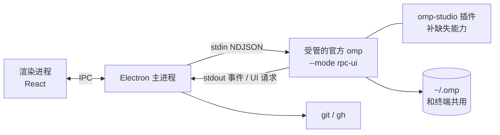

# omp-studio 计划

> 工作名，公开前再定正式名（不用 "Oh My Pi" 作产品名，避免被当成官方）。
> 记录日期：2026-10-17。来源：一次 grill-me 访谈，决策都经过确认。

## 1. 目标与定位

- **目标**：做成有人用、长期维护的开源项目（MIT）。
- **是什么**：oh-my-pi（omp）的桌面端，形态对标 Codex 桌面版、Claude Code 桌面版。
- **招牌（首发只靠这一点让人记住）**：设计和手感。功能不比竞品多，但每一处都更克制、更顺。
- **后续的差异点**：评审闭环、omp 专属能力（子代理、多模型角色）、中文用户。
- **投入**：每周 15 小时以上。
- **主平台**：Windows 优先打磨，macOS 后补。

### 竞品现状（2026-10 调研）

| 项目 | 栈 | 现状 |
|---|---|---|
| **[Tern](https://github.com/theblazehen/awesome-tern)（头号竞品）** | Stencil 官方，Rust 原生 | 终端 + 多路复用器，不是任务式桌面端。omp 对话在终端面板里原生渲染，有批准按钮、语音输入、浏览器画中画、git 视图；桌面、iOS、网页都能连同一个会话；关掉窗口会话也不断。负责安装和更新用户的 omp。omp 重度用户（内测对象）很可能已经在用 |
| [gooey-pi](https://github.com/am-will/gooey-pi) | Electron | 布局最像 Codex，但粗糙；同时服务 Pi/OMP/Prime，omp 特性没做透 |
| [oh-my-pi-gui](https://github.com/nornzach/oh-my-pi-gui) | Electron，自带 fork 的 omp | 像后台管理系统：侧栏 9 个功能入口压住会话列表，遥测常驻 |
| [omp-desktop](https://github.com/apoc/omp-desktop) | Tauri 2 | 黑客终端风，遥测栏占 1/5 屏，工具卡片和 diff 全部展开在对话流里 |

三个第三方桌面端的共同问题：过程优先而不是结果优先，遥测常驻，导航层级混乱。

Tern 不触发止损（它是终端，不是 Codex 式桌面端），但 omp-studio 必须回答：**已经在用 Tern 的人，为什么还要装它**（见第 9 节）。

## 2. 设计原则

1. **结果优先**：每一轮先给一句结论、几条要点、一张改动卡片（文件数、测试结果、审查 / 提交 / 开 PR）。
2. **过程默认折叠**：工具调用收成一行"已工作 X 分 · N 次工具调用 · M 个子代理"，点开才看。
3. **diff 有专属位置**：评审是独立的全屏模式，不塞进对话流。
4. **一个主导航**：侧栏只放任务（带状态点：进行中 / 等你确认 / 完成）；命令、用量、设置收进 `Ctrl K` 和设置页。
5. **遥测克制**：token、费用、速度默认不显示；上下文用到 70% 以上才在输入框里提示；子代理费用只在详情里出现。
6. **打磨标准参照 magpie**（[gui-shell 文档](https://github.com/yetone/magpie/blob/main/docs/subsystems/gui-shell.md)）：弹簧动效、遵守 reduced-motion、自绘覆盖式滚动条、窗口缩放时保住阅读位置、每个交互细节都有测试。

三张线框图（主界面 + 对话流、diff 评审、子代理泳道）在本次对话里定稿，阶段 1 转成高保真稿。

## 3. 已定的技术决策

| 决策 | 选择 | 理由 |
|---|---|---|
| 起点 | 从零写，只参考别人的代码 | fork 会继承竞品的设计包袱。RPC 对接、Windows 进程管理可以参考 omp-desktop、gooey-pi 的实现（都是 MIT） |
| 外壳 | **Electron** | Codex 和 Claude 桌面版在 Windows 和 macOS 上都是 Electron；两个平台同一个 Chromium，打磨一次就行。Tauri 在 mac 上换成 WKWebView，要再调一遍 |
| 接 omp 的方式 | 子进程 `omp --mode rpc-ui`，NDJSON over stdio，协商协议 v2 | omp 的 SDK 要求 Bun，Electron 主进程是 Node，用不了 SDK |
| omp 来源 | **安装包不带 omp。** PATH 上已经有 omp 就直接用（见下一行）；没有时才照 Tern 的做法自己管理一份官方 omp：从官方构建服务（`build.stencil.so`）下载原版 exe 并校验 sha256，放进应用数据目录的 `omp/versions/<版本>.exe`（保留最近 3 个），`omp/bin/omp.exe` 是当前版本，写 `omp/manager.json`；**自管的 omp 由 omp-studio 自己检查和更新，从不对它执行 `omp update`**（阶段 0 实测：`manager.json` 只在 exe 是 PATH 上的 `omp` 时才拦得住 `omp update`）；后台跟最新稳定版，优先下载差量补丁（omp-studio 自带 HDiffPatch 实现，补丁不可用时退回全量）；问一次要不要加进 PATH。和终端共用 `~/.omp` | Tern 就是这么做的（本机实测，细节见 `problem.md` 第 2 题）。安装包小 |
| 已有 omp | **有管理者的直接用；用户自己装的，照 Tern 问一次要不要接管**（仓库所有者 2026-10-18 确定）。有管理者的（exe 上两级目录有 `manager.json`，比如 Tern）直接用，由管理者更新，不碰 PATH。用户自己装的（install.ps1、bun、npm、brew 等）首次发现时弹窗问一次要不要由 omp-studio 接管：同意就按上一行自己管理一份，并把它的 `bin` 放到用户 PATH 最前面，原来那份不删不改；拒绝就继续用用户那份（脚本形式的 `omp.cmd` 启动不了，拒绝时提示这种安装方式用不了），升级按钮执行 `omp update` | 和 Tern 一致：Tern 能识别 Homebrew、Mise、Npm、Bun、install.ps1 几种来源，先问再接管，接管后放到 PATH 最前面（本机日志和 `tern.exe` 里的文字）。不和 Tern 抢 |
| 上游策略 | 只用官方正式版；缺的能力用自己写的 omp 插件补；补不了就给官方提 PR；**不 fork，也不打补丁** | 跑的是官方原版 exe，复用 Tern 时还是别人管理的 exe，补丁没地方打 |
| 界面语言 | 中英双语，第一天就做 | 设计规范同时覆盖两种字体和文案长度 |
| 仓库 | 独立仓库 `E:\work\code\omp-studio`，内测期间私有，公开时 MIT | |

### 已核实的 omp 能力（来自 omp 文档 `rpc.md`、`extensions.md`）

- RPC 有 wire schema，自动生成 TypeScript、Python、Rust、Go 类型；服务端的命令或事件没被 schema 覆盖时，omp 自己的 `bun check` 会失败。这说明协议是有人维护的契约。
- 子代理：`set_subagent_subscription`（`off` / `progress` / `events`），以及 `get_subagents`、`get_subagent_messages`、`cancel_subagent`、`steer_subagent`。泳道图的数据现成。
- 交互：`extension_ui_request`（select、confirm、input、editor、ask）走 RPC 往返；还有 host tools、host URI。
- extension API：`pi.on(...)` 生命周期事件、`sendMessage`，以及 `ctx.annotations.submit(...)`（"/annotate as an API, for boards and remote clients"），可以用来把逐行评论发给 agent。

## 4. 首发范围

全部做完才公开（理由：第一印象只有一次）：

1. 主界面 + 对话流（结果优先、过程折叠、审批和 ask 对话框）
2. diff 评审：逐行评论攒起来，一次性发给 agent，agent 在同一个 worktree 里继续改
3. 子代理泳道视图
4. worktree 生命周期：新建、合并回主分支、清理
5. commit、开 PR（git + gh）
6. 内置终端
7. 应用内登录和模型设置

## 5. 阶段

阶段顺序是我的建议，可以调整。每个阶段做完后发给内测用户。

### 阶段 0：技术验证

在 Windows 上把下面几件事各跑通一次，每一项都给出能复现的结论。背景、验证方法、备选方案和结论都在 `problem.md`（每项后面括号里是对应的题号）：

- [x] Electron 主进程启动官方 omp exe（`--mode rpc-ui`），协商 v2，发一个 prompt，完整收到流式事件，直到 `prompt_result`。（第 4 题；另发现主进程被强杀时会留下孤儿进程，已定：Job Object 兜底，同时查原因给 omp 提 PR）
- [x] 从官方构建服务下载 Windows exe，放在应用数据目录下运行，确认原生 addon 解压和 grep、bash 等工具都正常。（第 2 题）
- [x] 确认 `rpc-wire.generated.ts` 能不能从 npm 包直接引用；不能就自己从 omp 仓库生成或拷贝，随 omp 升级一起更新。（第 3 题，部分通：类型能引用，运行时代码不能；已定：从 omp 的 tag 拷贝）
- [x] 打开 `set_subagent_subscription: "events"`，跑一个会派子代理的任务，确认泳道图需要的开始时间、结束时间、模型、工具调用都拿得到。（第 5 题；帧里没有时间戳，用主进程接收时间）
- [x] 写一个最小的 omp 插件，在 RPC 模式下调用 `ctx.annotations.submit`，确认能带上文件和行号，agent 也能收到。（第 1 题，部分通：只能带单行，没有行范围；已定：改用宿主自己格式化消息）
- [x] 能找到 PATH 上的 omp，读出版本和管理者（`manager.json`），并能直接用 Tern 管理的、install.ps1 装的 omp 跑通上面的流程。（第 2 题；Tern 的在 Electron 和 Node 脚本里都跑过，install.ps1 的 18.8.7 只在 Node 脚本里跑过）

**出口条件**：任何一项不通，先回到这份计划重新评估（比如要等上游合并 PR，或者换一种实现方式）。

### 阶段 1：设计规范

- [x] 设计 token：中英文字体栈、字号层级、间距、颜色（深色和浅色）、圆角、动效曲线和时长、reduced-motion 下的处理。（`src/renderer/styles/tokens.css`、`docs/design/spec.md` 第 2 章）
- [x] 组件清单：任务行、状态点、消息、折叠的过程行、改动卡片、输入框和它的选项胶囊、审批对话框、diff 行、评论框、泳道。（`docs/design/spec.md` 第 4 章；diff 行、评论框、泳道只有规范，阶段 3/5 实现）
- [ ] 主界面、对话流、diff 评审、子代理泳道四个界面的高保真稿，中英文各一套。
- [x] "手感"检查清单，参照 magpie：滚动、流式渲染不跳动、窗口缩放保住阅读位置、快捷键、焦点管理。后面每个阶段都按这份清单验收。（`docs/design/spec.md` 第 7 章）

### 阶段 2：骨架和对话

- [x] 主进程 omp 连接：找 PATH 上的 omp 并读管理者、启动、协商 v2、`rpc_chunk` 重组、按 id 对应应答、等 `prompt_result`、关闭和按进程树结束（`docs/architecture/omp-rpc.md`）
- [x] 验证工具：RPC 录制回放的假 omp（`docs/architecture/rpc-replay.md`）
- [x] 验证工具（先于界面代码）：Playwright 启动 Electron 并截图
- [x] 应用外壳、单实例、窗口状态记忆、i18n 基础设施
- [x] omp 子进程放进 Windows Job Object，主进程崩溃或被强杀也不留孤儿进程（`problem.md` 第 4 题；决策 D2：koffi。`test/job-object.test.ts` 用 fake-omp 的孙进程验证强杀后无残留；真实 omp 的 bash 工具强杀场景还没跑）
- [x] 查清 omp 在宿主被强杀时为什么不结束 bash 等子进程（`problem.md` 第 4 题）：宿主被强杀时 omp 是被系统（libuv 的 Job）直接结束的，来不及清理孙进程，不是 omp 的缺陷，不提 PR（对 libuv 一半已实测，孙进程不受 libuv Job 管；真实 omp 没单独验证，见 `docs/architecture/task-model.md`）
- [x] 侧栏任务列表（按项目分组、状态点、跨项目显示"等你确认"）
- [x] 对话流：流式 Markdown、过程折叠、结论、改动卡片（改动卡片的数字从工具事件推算，不是 git 结果）
- [ ] 输入框：模型、思考强度、worktree、审批模式；steer 和 follow-up 消息队列（除 worktree 外已完成，worktree 归阶段 4）
- [x] 审批和 ask 对话框（`extension_ui_request`）（带超时的门和 ask 门只有单测，没有回放 fixture 覆盖）
- [x] 会话历史：读 `~/.omp`，能接着终端里的会话继续（恢复走 `resume-history` 回放验证；真实终端会话恢复没实测）
- [x] 应用内登录和模型设置，含 omp 全部设置（555 项，经 `omp config`）（OAuth 没有真实账号实测）
- [ ] omp 管理：PATH 上已有 omp 时的版本检查和升级提示；PATH 上的 omp 是脚本时询问是否接管；没有 omp 或用户同意接管时的首次下载和校验、放进 PATH、后台更新（差量补丁、多进程加锁、替换正在运行的 exe）（除差量补丁外已完成，目前全量下载；真实下载和 `omp update` 没实测）
- [ ] 审批模式跟随 omp 自己的配置：没在输入框里选过时不传 `--approval-mode`，用 `config.yml` 里的设置；用户选过才覆盖（仓库所有者 2026-10-18 要求，推翻 spec 决策 1"每次显式传 write"；改时同步 `docs/design/spec.md` 和 `src/main/tasks/task-pool.ts`）
- [ ] omp-studio 管理 omp 时和 Tern 一样做管理者：自己管的那份（PATH 上没有 omp 时下载的，或用户同意接管后下载的）装好后**直接**把 `bin` 放到用户 PATH 最前面，不再单独问"要不要加进 PATH"（去掉 `askAddToPath`）（仓库所有者 2026-10-18 要求；改时同步 `docs/architecture/omp-install.md`、`src/main/omp-manager/`）
- [ ] 有别的管理者（如 Tern）时也问一次要不要接管，和用户自装的同一个弹窗；同意后自己管一份并放到 PATH 最前面，Tern 的目录和 `manager.json` 不碰；拒绝就继续用 Tern 的（仓库所有者 2026-10-18 定）。开工前先实测：omp-studio 的 bin 排在前面后，Tern 会不会把自己再放回最前面、Tern 自己的终端里用的是哪个 omp、Tern 的"接管"提示会不会把 omp-studio 那份当成别人的 omp 来处理

### 阶段 2.5：工程基础（2026-10-18 盘点，内测前完成）

成熟软件的版本迭代和问题追查需要这些；都不涉及界面设计。前 5 项优先。

- [ ] 版本号：SemVer，内测期用 `0.x`。当前第一版定为 `0.1.0`；修 bug 升第三位，加功能升第二位，公开发布定 `1.0.0`。每次发版打 git tag `v<版本>`，设置页"关于"显示版本号（`getAppInfo` 已能读到 `app.getVersion()`）
- [ ] `CHANGELOG.md`：每个版本列新增、修复、变更，面向用户、中文；以后在线更新的"有新版本"提示从这里取
- [ ] 发版流程：改版本号、写 CHANGELOG、打 tag、打包，写成一个脚本，步骤写进 AGENTS.md 的命令表
- [ ] CI（GitHub Actions）：每次 push 跑 typecheck、单测、e2e；以后发版也在 CI 里打包（会用仓库所有者的 Actions 额度，开工前确认）
- [ ] 主进程日志：写到 `userData\logs\`，按天轮转，设置页能打开日志文件夹；不得记录 key，路径里的用户名要换掉（用库还是手写，开工前确认）
- [ ] 代码格式和静态检查：`tsc` 只查类型，查不出 React hooks 用错（依赖数组漏写、条件里调用 hook）这类问题，也不管格式；多个 agent 写代码时格式不统一，diff 里会混进无关改动，干扰评审。方案二选一，开工前由仓库所有者定：A. Prettier（格式）+ ESLint（typescript-eslint + react-hooks，只开少量规则）；B. Biome（一个工具同时做格式和检查，快，但 react-hooks 规则覆盖不如 ESLint 全）。定下后写进 AGENTS.md 技术栈表，命令表加 `npm run lint` / `npm run format`，CI 里一起跑
- [ ] "导出诊断信息"按钮（版本号、omp 版本、最近日志，打包成一个文件）；在线崩溃上报以后再说
- [ ] `LICENSE`（PLAN 定的 MIT）
- [ ] README：是什么、怎么装、怎么开发
- [ ] "帮助与反馈"改指向本仓库 Issues，加 bug 模板（要求附版本号和日志）
- [ ] Dependabot 每月提依赖升级；Electron 每 8 周一个大版本，要跟上安全更新
- [ ] `main` 分支保护：CI 不过不能合并（CI 有了之后）

完成阶段 2 和 2.5 后开始内测。

### 阶段 3：diff 评审

- [ ] 全屏评审模式：文件树、统一 / 并排 diff、暂存、丢弃
- [ ] 逐行评论、待发送队列、"发给 agent 修改"（宿主把评论格式化成一条带 `文件:行范围` 的用户消息，用 `prompt`、`steer` 或 `follow_up` 发送，不走 annotations 插件，见 `problem.md` 第 1 题）
- [ ] agent 的改动说明面板

### 阶段 4：worktree 和 git

- [ ] 每个任务一个 worktree：新建、项目级 setup 脚本、合并回主分支、丢弃、清理
- [ ] commit、push、用 gh 开 PR

### 阶段 5：子代理泳道

- [ ] 在"已工作"折叠区里展开泳道：时间轴、各子代理的状态和模型、主代理的工具节奏
- [ ] 选中某个子代理看详情：费用、token、摘要、完整记录、只看它的改动
- [ ] 用 `steer_subagent` 和 `cancel_subagent` 干预子代理

### 阶段 6：内置终端

- [ ] xterm.js + node-pty，每个任务的终端在它的 worktree 目录里打开

### 阶段 7：发布准备

- [ ] Windows 安装包、桌面端自身的自动更新（和 omp 的更新分开）。已讨论的方案（2026-10-18，未定）：electron-builder 改出 NSIS 安装包（装到用户目录，不需要管理员权限）+ electron-updater（新增运行时依赖，要仓库所有者同意）读 `latest.yml`、后台下载、提示重启，重启前走现有退出流程关掉 omp 子进程；GitHub Actions 打 tag 自动构建上传。待定：更新文件放哪（源码仓库私有，Releases 需要 token，不能写进应用；可选：单独的公开 releases 仓库 / 对象存储 / 开源后用本仓库）、是否签名（见下一条）、是否分 stable 和 beta 渠道。仓库所有者的第一需求是自己能在线更新测试
- [ ] 代码签名（竞品都没签名，签了就是一个差异点）
- [ ] CI 每天用最新的 omp 正式版和支持的最低版本各跑一遍 RPC 集成测试，提前发现上游变化
- [ ] 确定正式名称，写 README 和截图
- [ ] macOS 版（Electron 渲染一致，主要工作是打包、签名、公证）

## 6. 内测

- 从阶段 2 结束开始，找 3–5 个 omp 重度用户，私下分发，仓库保持私有。
- 每个阶段结束发一版，重点收集：会不会从终端或竞品换过来、哪里比竞品差。

## 7. 风险和对策

| 风险 | 对策 |
|---|---|
| **别人先做得更好**（访谈里最担心的一点） | 内测期间每月看一次竞品更新（Tern、gooey-pi、oh-my-pi-gui、omp-desktop、omp 官方动态） |
| 做完再公开，几个月没有外部反馈，做出只有自己喜欢的东西 | 阶段 2 结束就开始内测 |
| 范围大，研究生工作一忙就停 | 阶段之间独立、每个阶段都能用；阶段完成就打 tag |
| omp 上游变化把 RPC 对接搞坏（跟最新版，新版本会直接到用户手上） | 用 wire schema 生成的类型，按 schema 的解码规则容忍未知字段和帧；启动时检查 `protocolVersion`；CI 每天用最新正式版跑 RPC 集成测试，出问题当天修；保留最近 3 个版本，可以退回上一个 |
| 用 `manager.json` 判断 PATH 上的 omp 由谁更新，这个约定没写进 omp 文档 | 判断错了影响也小：升级按钮执行的 `omp update` 碰到受管的 omp 只会提示去管理者那里更新，不改文件。阶段 0 已实测，`omp update` 只认 PATH 上那个 omp 的 `manager.json`，所以升级按钮只对 PATH 上的 omp 用 |
| 用户自己装的 omp 版本不受我们控制，可能很旧 | 定一个支持的最低版本，低于它就提示升级；CI 同时跑最低版本和最新版 |
| 插件补不了的能力只能等上游 | 尽早提 PR；阶段 0 先把要用的能力逐个跑通 |

## 8. 止损条件

- **omp 官方发布桌面端**：停下来，或者改成给官方贡献设计。

## 9. 待验证的前提

详细的验证方法和备选方案见 `problem.md`。

- ~~`ctx.annotations.submit` 在 RPC 模式下能否精确对应到行~~：阶段 0 已验证，只能对应单行，评审改用宿主自己格式化消息（`problem.md` 第 1 题）。
- ~~官方 omp exe 放在应用数据目录下能否正常运行、能否直接用 Tern 管理的 omp~~：阶段 0 已验证，都能（`problem.md` 第 2 题）。
- 差异化：已经在用 Tern 的 omp 重度用户为什么还要装 omp-studio。阶段 1 之前要有答案，先问内测候选人。
- "竞品在 Windows 上更粗糙"：推测，没有实际装过竞品对比。阶段 1 前装 gooey-pi 和 oh-my-pi-gui 实测。
- "竞品不好看是因为 agent 写的、用了默认样式"：推测，不影响决策。
- **待讨论（仓库所有者 2026-10-18 提出）**：omp 在 RPC 模式下（桌面端就是这种模式）有几项默认值和终端版不同，`config.yml` 里没显式写时两边行为不一致。来源是 omp 文档 `rpc.md` 的 Startup 一节：不自动生成会话标题（`PI_NO_TITLE=1`）；`rpc-ui` 不用伪终端（`PI_NO_PTY=1`）；声明了 `protocolDefault` 的设置改用协议默认值，包括任务隔离/执行方式、memory、advisor 及其档位，RPC 还会固定后台任务和 bash/eval 自动转后台的默认值。要讨论的是：omp-studio 是否应该让这些项和终端版一致（比如显式读取并传入用户的终端默认值），还是接受差异、在设置页标明。

## 10. 参考

- omp RPC 协议：omp 文档 `rpc.md`；插件 API：`extensions.md`；SDK：`sdk.md`
- [Codex 和 Claude 桌面版用 Electron 的来源](https://codenote.net/en/posts/famous-electron-apps-2026-research)、[ChatGPT mac 版换成 Electron 版 Codex](https://mjtsai.com/blog/2026/07/10/chatgpt-work-and-chatgpt-classic)
- [Codex App Server 是怎么做的](https://openai.com/index/unlocking-the-codex-harness)
- [Claude Code 桌面版快速上手](https://code.claude.com/docs/en/desktop-quickstart)
- [omp 社区关于远程和多会话的讨论 #6460](https://github.com/can1357/oh-my-pi/discussions/6460)
- 打磨标准：[magpie gui-shell](https://github.com/yetone/magpie/blob/main/docs/subsystems/gui-shell.md)
- 打包、更新、签名可以参考：[CC Switch](https://github.com/farion1231/cc-switch)（Tauri，但发版流程通用）
