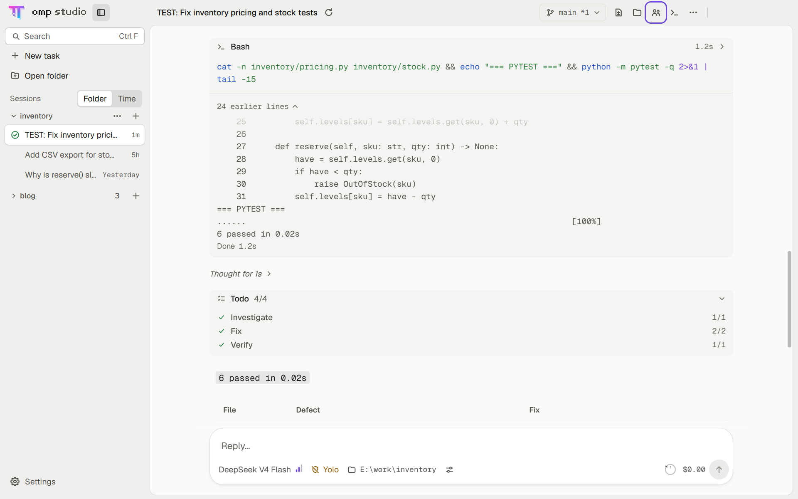
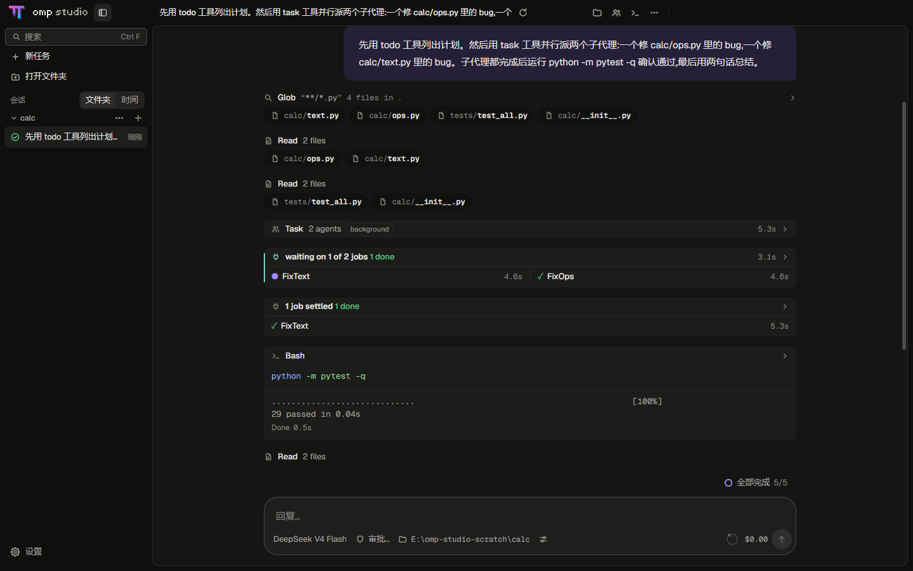
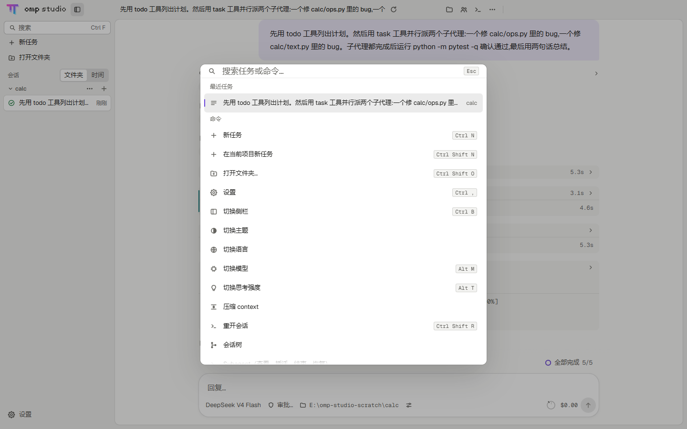
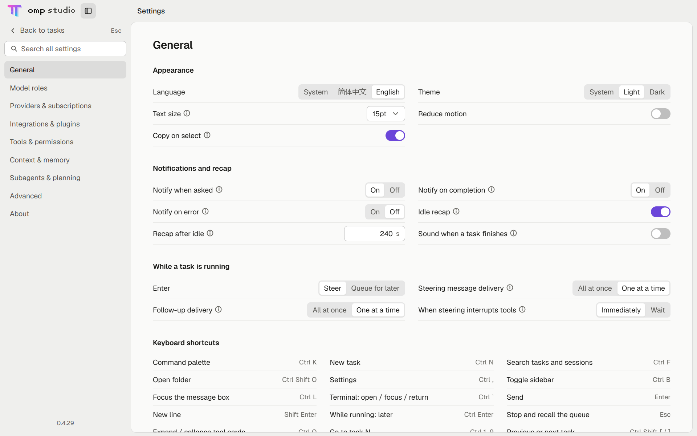

<div align="center">
  
  <h1>omp-studio</h1>
  <p><a href="https://github.com/can1357/oh-my-pi">oh-my-pi</a>（omp）的桌面端，运行官方原版 omp，与终端版共用登录、设置和会话。</p>
  <p><b>简体中文</b> · <a href="README.en.md">English</a></p>
  <p>
    <a href="#下载">下载</a> ·
    <a href="docs/architecture/">文档</a> ·
    <a href="CHANGELOG.md">更新日志</a> ·
    <a href="https://github.com/DawnJson/omp-studio/issues">反馈</a>
  </p>
  <p>
    
    
    
    <a href="LICENSE"></a>
  </p>
</div>

<table>
  <tr>
    <td width="50%"></td>
    <td width="50%"></td>
  </tr>
</table>

**`Ctrl+K` 命令面板**



**设置 → 通用：外观、通知、快捷键**



## 下载

| Windows（x64） | macOS（Apple 芯片） |
| --- | --- |
| [`omp-studio-<版本>-setup.exe`](https://github.com/DawnJson/omp-studio/releases/latest) | [`omp-studio-<版本>-arm64.dmg`](https://github.com/DawnJson/omp-studio/releases/latest)<br>[`omp-studio-<版本>-arm64-mac.zip`](https://github.com/DawnJson/omp-studio/releases/latest) |

### 系统要求

| | Windows | macOS |
| --- | --- | --- |
| 系统 | Windows 10 / 11 | macOS 13 Ventura 起 |
| 芯片 | x64 | Apple 芯片（arm64） |

- **Windows**：双击安装包，装到当前用户目录，不需要管理员权限。安装包未签名，第一次运行时在 SmartScreen 里点"更多信息 → 仍要运行"。
- **macOS**：把 `omp-studio.app` 拖进"应用程序"。包是 ad-hoc 签名，第一次打开前在终端执行 `xattr -cr /Applications/omp-studio.app`，或者在 系统设置 → 隐私与安全性 里点"仍要打开"。

omp-studio 处于内测阶段（`0.x`），仓库私有，Releases 和 Issues 对协作者开放。

## 功能

### 任务与对话

- 每个任务在伪终端里运行交互式 omp，界面按 omp 经 TSP 协议发来的节点绘制，工具卡片和思考块的展开折叠与终端版一致。
- 侧栏按项目列出任务，终端里开过的 omp 会话也在其中，点开接着聊。
- 审批和提问出现在输入框上方；有任务在等你时侧栏顶部出现提示条，`Ctrl+J` 跳过去。
- 窗口不在前台时任务栏闪烁，并按 omp 的通知设置发系统通知；关掉窗口后应用留在托盘，任务继续运行。

### 子代理与后台作业

- 输入框上方是待办板、子代理和后台作业。
- 子代理面板里查看每个子代理的输出，可以给它插话、结束或恢复它。
- `/btw` 在侧边面板里旁路提问，主对话不受打扰。

### 评审、git 与终端

- 评审（`Ctrl+Shift+D`）按文件或按行暂存、丢弃，提交信息可以由 omp 生成。
- 分支菜单里提交、推送、创建 PR、合并；git 仓库里的新任务可以开在独立 worktree 中。
- 内置终端（``Ctrl+` ``）打开在任务的工作目录；文件面板（`Ctrl+Shift+E`）显示文件树和预览。

### 设置与集成

- 设置覆盖 Provider 登录和 API key、自定义 provider、模型角色、MCP、Skills、插件市场，以及 omp 的全部设置项。
- 设置改动写进 omp 自己的配置，终端版同步生效。
- `Ctrl+K` 命令面板搜索任务、历史会话、命令和斜杠命令。
- 浅色、深色主题，中文、英文界面；对话过程区的文字与 omp 一样用英文。

macOS 上快捷键的 `Ctrl` 换成 `⌘`。

## 第一次启动

omp-studio 启动时在 PATH 上找 omp。由它管理的 omp 每小时检查一次新版本，在后台下载替换，有差量补丁时只下载补丁；运行中的任务继续用旧版本，新任务用新版本。设置 → 关于 → omp 里可以手动检查更新。

- **PATH 上没有 omp**：准备页列出下载来源 `build.stencil.so` 和文件大小，点"下载并安装"后下载官方构建并校验 sha256。Windows 上装到 `%LOCALAPPDATA%\omp-studio\omp\` 并放到用户 PATH 最前面，终端里敲 `omp` 用的是同一份；macOS 上装到 `~/Library/Application Support/omp-studio/omp/`。
- **PATH 上已有 omp**（自己装的，或由 Tern 等工具管理的）：omp-studio 只问一次。选"由 omp-studio 管理"会另装一份官方版放到用户 PATH 最前面，原来那份留在原处；选"继续用我的"，更新仍走它原来的安装方式。

## 常见问题

| 问题 | 解决 |
| --- | --- |
| 启动时提示"检测到脚本形式的 omp" | PATH 上第一个 omp 是 npm 等方式生成的 `omp.cmd`，omp-studio 只启动 `.exe`。点"由 omp-studio 管理"，另装的官方版会排到 PATH 最前面，原来那份保留。 |
| 怎么更新 omp-studio | Windows：启动 10 秒后自动检查一次，之后每小时一次，也可以点 设置 → 关于 → 检查更新；下载完点"重启并安装"；显示"这个版本没有配置更新源"时，从 [Releases](https://github.com/DawnJson/omp-studio/releases/latest) 下载新版安装包运行。macOS：从 Releases 下载新版本替换。 |
| 怎么报告问题 | 先在 设置 → 关于 → 问题排查 里点"导出诊断信息…"，文件含版本、系统、omp 状态和最近 3 天的日志，用户名、家目录和 key 已去掉。再按 `Ctrl+K` → 关于与反馈 → 报告问题，按模板填写，把文件拖进"诊断信息"框。截图里的模型提供商账户信息先打码。 |
| 数据存在哪里 | 登录、模型、设置和会话都在 `~/.omp`，与终端版 omp 共用。 |

## 开发

需要 Node.js 24 以上；`npm run dist:mac` 在 macOS 上运行。

```powershell
npm ci
npm run dev        # 开发，热更新
npm test           # 单元测试（Vitest）
npm run dist       # Windows NSIS 安装包，输出到 release/
npm run dist:mac   # macOS arm64 的 dmg 和 zip，输出到 release/
```

架构文档在 [`docs/architecture/`](docs/architecture/)，界面规范在 [`docs/design/spec.md`](docs/design/spec.md)，版本变化在 [`CHANGELOG.md`](CHANGELOG.md)。

## 致谢

- [oh-my-pi](https://github.com/can1357/oh-my-pi)：omp 本身
- [Tern](https://docs.stencil.so/tern/protocol/)：TSP 协议规范
- [Electron](https://www.electronjs.org/)
- [node-pty](https://github.com/microsoft/node-pty)：伪终端
- [xterm.js](https://xtermjs.org/)：内置终端
- [markdown-it](https://github.com/markdown-it/markdown-it)、[KaTeX](https://katex.org/)、[Shiki](https://shiki.style/)：Markdown、公式和代码高亮
- [Geist](https://vercel.com/font)：界面字体（SIL OFL 1.1）
- [LobeHub Icons](https://github.com/lobehub/lobe-icons)：模型提供商的 logo

## 许可

[MIT](LICENSE)。omp-studio 是暂定名，由第三方独立开发。
