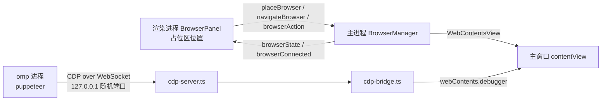

# 浏览器面板：右栏的网页，也是 omp 用的浏览器

每个任务一个页面，显示在右栏（spec §4.29）。同一个页面也是这个任务的 omp `browser` 工具用的浏览器：AI 操作的就是面板里这一页，用户看得见，登录状态共用。

## 结构

- `src/main/browser/browser-manager.ts`：每个任务一个 `TaskBrowser`（`WebContentsView` + CDP 口）。页面按需建、没人用时关（见「没人用时」）；任务归档 / 删除、应用退出时连 CDP 口一起关。所有任务共用一个持久分区：登录状态记住，和应用自己的页面隔开；一切权限请求拒绝。
- `cdp-bridge.ts`：对 omp 装成只有一个标签页的 Chrome。不 import electron，单测用假页面。
- `cdp-server.ts` + `websocket.ts`：每个任务一个只听 `127.0.0.1` 的 HTTP + WebSocket 口，自己实现最小的 RFC 6455 服务端（不加 `ws` 依赖）。
- `address.ts`：地址栏文字 → 地址（只放行 http/https，不像地址的当搜索词）。
- 渲染进程 `src/renderer/src/features/browser/`：`BrowserPanel`、`BrowserToggle`、`browser-store.ts`。

## omp 怎么用上它

1. 主进程起 TSP 任务时（`tasks/runtime.ts` 的 `buildLaunch`）向 `BrowserManager.endpoint(taskId)` 要 CDP 口（第一次要时才开），以 `STUDIO_BROWSER_CDP` 放进 omp 的环境变量。
2. studio 内置的 omp 扩展 `client-accounts/extension/studio-browser.mjs`（和账号插件一起部署）看到这个变量时，在 `session_start` 里用 `lookup("browser.cdpUrl").override(...)` 把本进程的 `browser.cdpUrl` 指过去：只改内存运行时层，不写配置；用户自己配了（`isConfigured`）就不动；终端里直接跑的 omp 没有这个变量，不受影响。
   - **不能在扩展加载时改**：任务里 agent 跑的 `omp usage` / `models` / `commit` 等子命令也继承这个变量，它们不初始化设置，读 `pi.pi.settings` 抛 "Settings not initialized"，整个扩展加载失败、账号插件的 provider 全都不见（omp 18.18.6 实测）；子命令没有会话，不触发 `session_start`。
3. omp 的 `browser` 工具 `puppeteer.connect` 到这个口，打开的是面板里的页面。

连上时主进程发 `browserConnected`，这个任务是当前任务就打开面板，**不抢焦点**。

## CDP 转接（omp 18.13.1 实测，puppeteer 25）

puppeteer 25 用 Chrome 的 tab 目标模型（每个页面一个 `tab` 目标和一个 `page` 目标）。连法：

1. `GET /json/version` 拿 `webSocketDebuggerUrl`（路径带只在这里给出的随机 token）。
2. 根会话：`Target.setDiscoverTargets`、`Target.setAutoAttach` → 转接发 `attachedToTarget`（`tab`）。
3. tab 会话：`Target.setAutoAttach` → 在 tab 会话下发 `attachedToTarget`（`page`）；`Runtime.runIfWaitingForDebugger`。
4. page 会话的命令转给 `webContents.debugger.sendCommand`；iframe、worker 等子会话 id 原样透传。页面 debugger 的事件：根会话的换成各客户端自己的 page 会话 id，子会话的保留原 id。
5. omp 自己的扩展命令 `OMP.claimTarget` 回 `-32601` 即可，它照常继续。

要点：

- **地址为空的目标 puppeteer 当作没初始化**，omp 报 `No page targets available on the attached browser`。所以新页面一建好就载入 `about:blank` 并发 `Target.targetInfoChanged`（地址栏不显示它）。e2e"面板没打开过时 omp 连上来"守着。
- **视图要挂在窗口上**：不挂的 `WebContentsView` 截图会一直等；挂着但 `setVisible(false)` 照样能截图、跑脚本（Electron 44 实测）。所以面板关着时视图仍挂着、只是隐藏；有 CDP 客户端时关后台节流。
- **只有一个页面**：`Target.createTarget` 和页面里的 `window.open` / `target=_blank` 都在原页面打开。
- **omp 关不掉用户的页面**：`Browser.close`、`Page.close`、`Target.closeTarget` 等一律回错误。
- 最后一个 page 会话断开时摘掉 debugger，omp 设的仿真（视口、UA）随之失效。

## 安全

- CDP 口放行条件：`Host` 头是这个口本身（挡 DNS rebinding）、没有 `Origin` 头（网页发起的请求都带，puppeteer 不带）、WebSocket 路径带随机 token。风险面和 Chrome 自己开调试口一样，token 只经环境变量交给这个任务的 omp。
- 页面视图：`sandbox`、`contextIsolation`、无 `nodeIntegration`、无 `webviewTag`、独立分区、拒绝所有权限；只能导航到 http/https/`about:blank`。应用自己的窗口仍只加载 `app://studio/`。

## 和界面的配合

- 页面是原生视图，叠在应用页面上。渲染进程把占位区位置告诉主进程（`placeBrowser`，CSS 像素，主进程乘页面缩放），触发点：`ResizeObserver`、窗口 resize、面板滑入动画结束（滑入用 transform，`ResizeObserver` 看不到）。
- **原生视图压住的地方点不到应用页面**：占位区四周让出边距（`browser.css`），左边要让出面板拖拽条，否则拖拽条只剩头部一段拖得动；视图圆角与占位区一致，不压住面板圆角和描边。拖动中指针移到页面上照样发给应用页面（按下时应用页面拿着捕获，Electron 44 实测）。Playwright 鼠标不经这层命中，e2e 只能守占位区和拖拽条的位置关系。
- 头部按钮的悬停提示要画在上方（`data-tip-side="top"`），画在下方会被页面挡住。
- 遮罩弹窗开着（`ui/title-bar-dim.ts` 的计数）、或 body 下的浮层压到占位区时，`placeBrowser("covered")` 把视图藏起来，否则浮层被挡。面板关掉或换任务发 `placeBrowser(null)`：主进程据此区分"暂时挡住"和"面板关了"，只有后者会关页面。
- 面板关着、omp 还在时页面和 CDP 连接都留着，omp 在后台继续用。

## 没人用时

- **后台节流**：没有 CDP 客户端时开 `setBackgroundThrottling(true)`，客户端连上时关、最后一个断开时再开。面板显示着时节流不影响页面（推断：Chromium 只节流隐藏页面，没实测）。
- **关页面**：omp 进程不在（任务 stopped / error）、面板关着、没有 CDP 客户端，三样同时成立时关页面（省一个渲染进程），记下地址（只记 http/https）。任一条件变化时检查一次。CDP 口不关：它的地址在 omp 的环境变量里，任务重开还用它。
- **再载入**：下次建页面先载入 `about:blank`，载完仍是它就载入记下的地址；被别的跳转打断就不载入。记下的地址用过或被打断即清掉。登录状态还在；滚动位置、表单、前进后退历史不保留。
- omp 在不在：`browser/runtime.ts` 按任务状态事件记一份在跑的任务，新建的 `TaskBrowser` 从它取初值，omp 在跑但还没连上时开关面板不会误关页面。
- 实测（Windows 11 26300，Electron 44.9，挂在窗口上的视图，页面每帧画 40 个色块 + 10ms 忙 1ms 的定时器）：

  | 视图 | 节流 | `requestAnimationFrame` | 10ms 定时器 | `visibilityState` | 页面进程 CPU（单核） |
  |---|---|---|---|---|---|
  | 显示 | 关 | 144 帧/秒 | 100 次/秒 | visible | 25.7% |
  | `setVisible(false)` | 关 | 1 帧/秒 | 100 次/秒 | visible | 10.2% |
  | `setVisible(false)` | 开 | 0 | 1.2 次/秒 | hidden | 0.1% |

  隐藏 + 节流时 `Page.captureScreenshot` 照样完成（约 2.0 s）。关掉这个测试页后应用工作集合计少 81 MB（真实网站多半更多，推断）。

## 测试

- `test/browser-cdp.test.ts`：转接连法、命令路由、事件改写、禁止的命令、断开摘 debugger；CDP 口的 token、`Origin`、`Host` 校验。
- `test/browser-address.test.ts`：地址栏解析。
- `test/e2e/browser.e2e.ts`：假 omp（`FAKE_OMP_BROWSER_FILE` 记下 `STUDIO_BROWSER_CDP`）+ 测试自己当 omp 连上去。
- 真实 omp（18.13.1，临时 agent 目录 + 假 OpenAI 模型让 omp 调 eval 跑 `browser.open()` 等）：插件覆盖生效，omp 打开的是面板页面，面板自动打开，地址栏跟随，输入框焦点保留。
