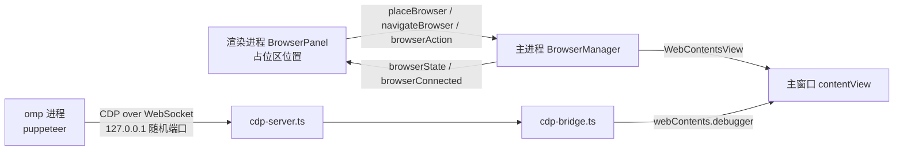

# 浏览器面板：右栏的网页，也是 omp 用的浏览器

每个任务一个页面，显示在右栏（spec §4.29）。用户在这里打开网页；同一个页面也是这个任务的 omp `browser` 工具用的浏览器：AI 打开、点击、截图的就是面板里这一页，用户看得见，登录状态共用。

## 结构

- `src/main/browser/browser-manager.ts`：每个任务一个 `TaskBrowser`（`WebContentsView` + CDP 口）。页面在面板显示、输入地址或 omp 连上时建；没人用时关掉（见下面「没人用时」）；任务归档 / 删除（`taskRemoved`）、应用退出（`registerShutdownHook`）时连 CDP 口一起关。所有任务共用分区 `persist:studio-browser`：登录状态记住，和应用自己的页面隔开；一切权限请求拒绝。
- `cdp-bridge.ts`：对 omp 装成只有一个标签页的 Chrome。不 import electron，单测 `test/browser-cdp.test.ts` 用假页面。
- `cdp-server.ts` + `websocket.ts`：每个任务一个 HTTP + WebSocket 口（只听 `127.0.0.1`，不用 `ws` 依赖，自己实现最小的 RFC 6455 服务端）。
- `address.ts`：地址栏的文字 -> 地址。只放行 http/https；带空格或不像主机名的当搜索词（Bing）；`localhost`、`127.x`、`[::1]` 补 `http://`，别的补 `https://`。
- 渲染进程 `src/renderer/src/features/browser/`：`BrowserPanel`（头部 + 占位区）、`BrowserToggle`（顶栏按钮）、`browser-store.ts`（开关、各任务页面状态）。

## omp 怎么用上它

1. 主进程起 TSP 任务时（`tasks/runtime.ts` 的 `buildLaunch`）向 `BrowserManager.endpoint(taskId)` 要这个任务的 CDP 口（第一次要时才开），以 `STUDIO_BROWSER_CDP=http://127.0.0.1:<端口>` 放进 omp 的环境变量。
2. studio 内置的 omp 扩展（`client-accounts/extension/studio-browser.mjs`，和账号插件一起部署在 `<agent 目录>/extensions/studio-accounts/`）在加载时看到这个变量，用 `@oh-my-pi/pi-coding-agent/config/registry` 的 `lookup("browser.cdpUrl").override(...)` 把这个进程的 `browser.cdpUrl` 指过去。只改内存里的运行时层，不写配置；用户自己配了 `browser.cdpUrl`（`isConfigured`）就不动；终端里直接跑的 omp 没有这个变量，不受影响。
3. omp 的 `browser` 工具（eval 里的 `browser.open()`）就 `puppeteer.connect` 到这个口，打开的是面板里的页面。

连上时（WebSocket 建立）主进程发 `browserConnected`，渲染进程在这个任务是当前任务时打开面板，**不抢焦点**（输入框的焦点留着）。

## CDP 转接（omp 18.13.1 实测，puppeteer 25）

puppeteer 25 用 Chrome 的 tab 目标模型：每个页面有一个 `tab` 目标和一个 `page` 目标。实测的连法：

1. `GET /json/version` 拿 `webSocketDebuggerUrl`（路径带只在这里给出的随机 token）。
2. 根会话：`Target.getBrowserContexts`、`Target.setDiscoverTargets {discover, filter}`、`Target.setAutoAttach {autoAttach, waitForDebuggerOnStart, flatten}` → 转接发 `attachedToTarget`（`tab`）。
3. tab 会话：`Target.setAutoAttach` → 转接在 tab 会话下发 `attachedToTarget`（`page`）；`Runtime.runIfWaitingForDebugger`。
4. page 会话里的命令转给 `webContents.debugger.sendCommand`（第一次用时 `attach("1.3")`）；页面里的子会话（iframe、worker，`Target.attachedToTarget` 来自页面 debugger 的事件）的 id 原样透传。页面 debugger 的事件：根会话的换成各客户端自己的 page 会话 id，子会话的保留原 id。
5. omp 还会发 `OMP.claimTarget`（omp 自己的扩展命令），回 `-32601` 没找到即可，它照常继续。

要点：

- **地址为空的目标 puppeteer 当作没初始化**，`browser.targets()` 里没有它，omp 报 `No page targets available on the attached browser`。所以新页面一建好就载入 `about:blank`，载完发 `Target.targetInfoChanged`（地址栏不显示 `about:blank`）。e2e `test/e2e/browser.e2e.ts` 的"面板没打开过时 omp 连上来"一条守着它。
- **视图要挂在窗口上**：不挂在窗口上的 `WebContentsView` 截图（`Page.captureScreenshot`）会一直等；挂着但 `setVisible(false)` 的照样能截图、跑脚本（Electron 44 实测）。所以面板关着时视图仍挂在主窗口上、只是隐藏；有 CDP 客户端连着时 `setBackgroundThrottling(false)` 让它照常渲染（没有客户端时开节流，见「没人用时」）。
- **只有一个页面**：`Target.createTarget` 在这个页面里打开地址、返回它的 id；页面里的 `window.open` / `target=_blank` 也在原页面打开。
- **omp 关不掉用户的页面**：`Browser.close`、`Page.close`、`Target.closeTarget` 等不管从哪一级发来都回错误，不执行。
- 最后一个 page 会话断开时摘掉 debugger：omp 设的仿真（视口、UA）随之失效，面板恢复成用户看到的样子。

## 安全

- CDP 口只听 `127.0.0.1`。放行条件：`Host` 头是这个口本身（挡 DNS rebinding）、请求没有 `Origin` 头（网页里发起的请求都带，omp 的 puppeteer 不带），WebSocket 路径带随机 token。本机别的程序拿到 token 才连得上——和 Chrome 自己开调试口一样的风险面，token 只经环境变量交给这个任务的 omp。
- 页面视图：`sandbox`、`contextIsolation`、无 `nodeIntegration`、无 `webviewTag`、独立分区、拒绝所有权限；只能导航到 http/https/`about:blank`（`will-navigate`、`setWindowOpenHandler`）。应用自己的窗口仍只加载 `app://studio/`。

## 和界面的配合

- 页面是原生视图，叠在应用页面上面。渲染进程把占位区（`browser-view`）的位置告诉主进程（`placeBrowser`，CSS 像素，主进程乘页面缩放）：`ResizeObserver` + 窗口 resize + 面板滑入动画结束（`animationend`，滑入用 transform，`ResizeObserver` 看不到位置变化）。
- 原生视图压住的地方鼠标点不到应用页面：占位区左边让出面板拖拽条（`.file-preview-resizer`，4px）的宽度（`browser.css` 的 `margin`），否则拖拽条只剩头部那一段拖得动（2026-10-29 修，此前用户反映调不了宽度）。右边和下边也留 4px，视图圆角 6px（主进程 `view.setBorderRadius(6)`，和占位区的 `--radius-md` 一致），不压住面板的圆角和描边。拖动中指针移到页面上照样发给应用页面（按下时应用页面拿着捕获；窗口消息模拟拖动实测，Electron 44）。Playwright 的鼠标直接发给应用页面的 webContents，不经过这层命中，e2e 用占位区和拖拽条的位置关系守着。
- 页面视图盖在头部下面，头部按钮的悬停提示要画在上方（头部带 `data-tip-side="top"`，`ui/Tooltip.tsx`），画在下方会被页面挡住。
- 遮罩弹窗开着（`ui/title-bar-dim.ts` 的计数）、或 body 下的浮层（菜单、下拉、toast）压到占位区时，把视图藏起来（`placeBrowser("covered")`），否则浮层会被它挡住。原生 `title` 提示不在页面里，不用管。面板关掉或换到别的任务（`BrowserPanel` 卸载）发 `placeBrowser(null)`：主进程据此区分“面板开着、暂时挡住”和“面板关了”，只有后者会关页面。
- 面板关掉时视图隐藏，omp 还在时页面和 CDP 连接都留着：omp 在后台继续用，再打开还是原来那页。

## 没人用时（2026-10-28）

- **后台节流**：没有 CDP 客户端连着时页面开 `setBackgroundThrottling(true)`，客户端连上（`CdpBridgeHost.connected`）时关掉、最后一个断开（`disconnected`）时再开。面板显示着时节流不影响页面（推断：Chromium 只节流隐藏的页面，没有实测显示 + 节流开的组合）。
- **关页面**：omp 进程不在（任务状态 stopped / error，`tasks/runtime.ts` 的 `state` 事件 → `setTaskBrowserOmpRunning`）、面板关着、没有 CDP 客户端，三样同时成立时关掉页面（省一个渲染进程），记下地址（只记 http/https）。这三样任一变化时（任务状态、`placeBrowser(null)`、最后一个客户端断开）检查一次。CDP 口不关：它的地址在 omp 的环境变量里，任务重开时还用同一个。
- **再载入**：下次建页面（面板再打开、omp 再连上、地址栏输入）时照旧先载入 `about:blank`，载完仍是 `about:blank` 的话载入记下的地址；`about:blank` 被别的跳转（omp 的 `Target.createTarget`、地址栏）打断就不载入。记下的地址用过或被打断就清掉，之后停在 `about:blank` 时再关不会翻出旧地址。会话分区是持久的，登录状态还在；滚动位置、表单内容、前进后退历史不保留。
- omp 在不在：`browser/runtime.ts` 按任务状态事件记一份在跑的任务，新建的 `TaskBrowser` 从它取初值（不等下一次状态事件），所以 omp 在跑但还没连上时开关面板不会误关页面。
- 实测（2026-10-28，Windows 11 build 26300，Electron 44.9，临时 Electron 脚本：挂在窗口上的 `WebContentsView`，页面每帧在 1024×768 画布上画 40 个色块，另有 10ms 定时器每次忙 1ms）：

  | 视图 | 节流 | `requestAnimationFrame` | 10ms 定时器 | `visibilityState` | 页面进程 CPU（单核） |
  |---|---|---|---|---|---|
  | 显示 | 关 | 144 帧/秒 | 100 次/秒 | visible | 25.7% |
  | `setVisible(false)` | 关（以前的做法） | 1 帧/秒 | 100 次/秒 | visible | 10.2% |
  | `setVisible(false)` | 开 | 0 | 1.2 次/秒 | hidden | 0.1% |

  隐藏 + 节流开着时 `Page.captureScreenshot` 照样完成（约 2.0 s，节流关时约 2.5 s）。关掉这个页面后应用所有进程的工作集合计少 81 MB（这个测试页；真实网站多半更多，推断）。

## 测试

- `test/browser-cdp.test.ts`：转接的连法、命令路由、事件改写、禁止的命令、断开时摘 debugger；CDP 口的 token、`Origin`、`Host` 校验。
- `test/browser-address.test.ts`：地址栏文字的解析。
- `test/e2e/browser.e2e.ts`：假 omp（`FAKE_OMP_BROWSER_FILE` 记下 `STUDIO_BROWSER_CDP`）+ 测试自己当 omp 连上去：面板位置、弹窗时隐藏、连上自动打开且不抢焦点、omp 看到的是用户的页面、跳转时地址栏跟着变、关不掉页面；新页面目标有地址；窄窗口中英文不越界。
- 真实 omp（18.13.1，2026-10-28，临时 agent 目录 + 假 OpenAI 模型让 omp 调 eval 跑 `browser.open()` / `tab.goto()` / `tab.title()`）：插件覆盖生效，omp 打开的是面板里的页面，面板自动打开，地址栏显示 omp 打开的地址，输入框焦点保留。探针用完已删。
