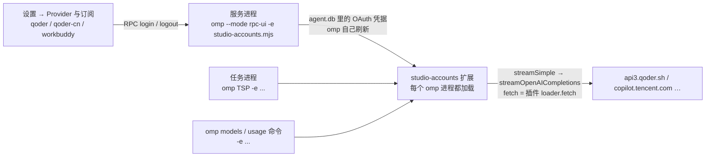

# 内置 magpie 插件：第三方客户端账号

目标：把 magpie 那套"本地代理 + 账号"的能力搬进 studio —— 在设置里登录自己的 Qoder / WorkBuddy 等客户端账号，它套餐里的模型出现在模型选择器里，任务直接用。不装 magpie、不依赖 magpie 在跑、不自带它的 exe。

状态：仓库所有者 2026-10-25 提出并选了 omp 扩展路线 + 内置 magpie 社区的 MIT 插件（原样 vendor，不做用户自装插件的安装系统）。**已实现**：Qoder、Qoder CN、WorkBuddy、WorkBuddy AI 四个 provider；Qoder CN 和 WorkBuddy 用仓库所有者的真实账号走通了登录 → 模型列表 → 一轮对话（第 11 节）。

## 0. 结论

**用一个 studio 自带、随每个 omp 进程加载的 omp 扩展（`-e <绝对路径>`）实现，不用本地 HTTP 网关、不写 `models.yml`、不自己存 token。**

| 路线 | 做法 | 判断 |
|---|---|---|
| A 依赖 magpie | studio 把 `http://127.0.0.1:3425/v1` 当普通 OpenAI 兼容提供商加进 `models.yml` | 否：要求用户装 magpie 并一直开着；登录、模型列表、账号都在 magpie 那边，studio 只是个壳；magpie 不在跑时模型不可用；和"studio 自带这个功能"相反 |
| B studio 主进程网关 | 主进程起 `127.0.0.1:<port>` 网关 + 自己加密存 token + 写 `providers.<id>` | 能实现，但四样新东西（本地端口、网关密钥、safeStorage 凭据库、`models.yml` 的自动写）都要单独批准和维护；omp 侧全靠 `openai-completions` 反推 |
| **C omp 扩展** | 扩展里 `pi.registerProvider(id, {api, oauth, fetchDynamicModels, streamSimple, models, usage})`；studio 只负责把扩展文件放好并给每个 omp 进程传 `-e` | **推荐**：端口、网关密钥、凭据库、`models.yml` 全不需要；登录走 omp 自己的 OAuth（凭据进 agent.db，和终端版共用、由 omp 加密和刷新）；模型进 omp 的模型列表；请求整形全部在扩展里 |

C 的代价：多一份随应用发布的第三方 JS（MIT），并且这几个 provider **只在 studio 起的 omp 里有**（任务进程、服务进程、studio 跑的命令），终端版 omp 看不到，除非用户在 omp 的 `extensions:` 里自己加。这正好是"studio 自带"的意思。

## 1. 依据（npm 上的 `@oh-my-pi/pi-coding-agent` / `pi-ai` 18.12.6 源码；还没跑）

- `ProviderConfigInput`（`src/config/model-registry.ts`）支持 `api`、`streamSimple`、`oauth: {name, login, refreshToken, getApiKey, modifyModels}`、`fetchDynamicModels(apiKey)`、`models[]`、`usage`。
- `registerProvider()` 里：`streamSimple` + 自定义 `api` → `registerCustomApi()`；`oauth` → `registerOAuthProvider()`（进全局 OAuth 注册表）；`apiKey` 在有 oauth 时降级为 fallback（登录的凭据优先）。
- RPC `get_login_providers` 就是 `getOAuthProviders()`（`modes/rpc/rpc-mode.ts`）→ 扩展注册的 provider 会出现在 studio 现有的"连接提供商"列表里，登录方式按未知 provider 当 `oauth` 处理（`src/shared/provider-login.ts` 的默认分支），界面不用改。
- RPC `login`：`onAuth` → `extension_ui_request` 的 `open_url`；`onPrompt`（在 `onAuth` 之后）→ `input`；`onProgress` → `notify`；登录成功后 omp 自己跑 `refreshProvider(provider, "online")` 重新发现模型。**`onPrompt` 带 `secret: true` 在 RPC 模式被直接拒绝**（"Use the terminal UI to log in"），`onAuth` 之前调 `onPrompt` 也被拒。
- `streamOpenAICompletions(model, context, options)` 用 `options.fetch ?? fetch`（`providers/openai-completions.ts`），可以从 `@oh-my-pi/pi-ai/providers/register-builtins` 导入（包的 `./providers/*` 子路径导出）。所以扩展的 `streamSimple` 只要把插件那个"接管 fetch"的 loader 塞进 `options.fetch`，SSE、工具调用、思考块、流式错误全交给 omp。
- `--extension <path>` / `-e`（`cli-reference.md`、`extension-loading.md`）：参数是绝对路径；`--no-extensions` 下 `-e` 仍然加载；加载失败会让 omp 启动失败（所以要先确认文件在位）。

## 2. 架构



- studio 不碰 token：登录、刷新、存取都在 omp 里（AGENTS.md「omp 的边界」不用加例外）。
- studio 不写 `models.yml`：provider 是运行时注册的。
- 扩展不是子进程，没有孤儿进程；扩展加载失败会让 omp 起不来，所以部署和参数都要先校验。

## 3. 扩展

### 3.1 文件、部署、加载

- 源文件（相对 studio 仓库）：`src/main/client-accounts/extension/` —— `studio-accounts.mjs`（入口，注册哪几个 provider）+ `shim.mjs`（插件 → `pi.registerProvider` 的接线）+ `adapter.mjs`（纯映射，能被单测直接 import）+ `adapter.d.mts`（它的类型声明，只给仓库里的 TS 用）+ `vendor/qoder/index.mjs`、`vendor/qoder/LICENSE-CLIProxyAPI`（MIT，原样 vendor）+ `NOTICE.md`（上游仓库、版本、哈希、更新步骤）。
- 打包：用 `?raw` 把这几份文件的原文并进主进程 bundle（`src/main/vite-raw.d.ts` 已有先例），由 `deploy.ts` 写到 `userData/omp-extensions/accounts-<内容哈希>/`，内容没变就不重写、旧哈希目录删掉。**不放进 asar**：omp 是另一个进程，读不了 asar。这样 `electron-builder.yml` 的 `files` 不用改（AGENTS.md「安装包里只有应用本身」）。
- 加载：`buildOmpArgs`、`buildTspArgs` 和 `runOmpCommand` 统一带 `-e <入口>`（路径由 `extension-path.ts` 的单例给出，启动时 `prepareAccountExtension()` 部署一次；部署失败只记日志，不拦任何功能）。用户自己的 `extensions:` 不受影响（不加 `--no-extensions`）。
- `vendor/` 原样保留：加进 `.prettierignore` 和 `.oxlintrc.json` 的 `ignorePatterns`，不格式化也不 lint，方便和上游 diff。
- 写入的目录在 userData（studio 自己的），不是 `~/.omp`。

### 3.2 每个 provider 注册成什么

实际代码（`shim.mjs` 的 `registerAccountProvider`，`studio-accounts.mjs` 里调两次）：

```js
pi.registerProvider("qoder", {
  api: "studio-qoder",                  // 扩展自有 api（内置名保留），streamSimple 由我们实现
  baseUrl: "https://api3.qoder.sh",     // 必填；请求由插件的 loader.fetch 决定，不用它
  oauth: {
    name: "Qoder",
    async login(callbacks) { /* 插件 auth.methods[无 prompts 的那个].authorize → onAuth(url) → callback() 轮询 */ },
    async refreshToken(credentials) { /* 插件 auth.refresh；omp 在到期前 60 秒或 401 时调 */ },
    getApiKey(credentials) { /* 同步模块缓存（每次请求都会调），返回 credentials.access */ },
  },
  async fetchDynamicModels() { /* 插件 provider.models({auth}) → 映射成 omp 的模型行 */ },
  streamSimple(model, context, options) {
    return streamOpenAICompletions({ ...model, api: "openai-completions" }, context, {
      ...options,
      fetch: pluginFetch(plugin, options?.sessionId, () => credentials),
    });
  },
});
```

- 凭据原样存：omp 的凭据库把 OAuth 凭据当 JSON 整段存（`serializeCredential` 只摘 `type`），所以插件凭据里的 `uid`、`machineId`、`deviceToken`、`pat`、`deviceChat`、`vpc` 都能原样往返，不需要拆进 `accountId`。**两个方向各管一头**：存进 omp 时摘掉插件自己的 `type:"success"`（`stripType`，omp 写的是 `{type:"oauth", ...结果}`，`type` 在后、不改就会被覆盖成非法值）；交给插件时再补回 `type:"oauth"`（`toPluginAuth`，插件的 `auth.loader(getAuth)` 第一句就是 `if (auth?.type !== "oauth") return {}`，少了它任务里会报 `the bundled plugin returned no fetch`）。2026-10-25 实测踩过：登录、模型列表都正常，第一条消息就报这个错。
- refresh 只有一个发起人：Qoder 的 refresh token 一次性，插件自己会在到期前 5 分钟刷。喂给插件的凭据用 `stretchExpiry` 把 `expires` 推到至少一天后（插件就不自己刷），真正刷新由 omp 调 `refreshToken`。插件万一还是刷了，`client.auth.set` 的 shim 只更新内存（omp 存的旧凭据下次启动会失败一次），所以 `set()` 是排查点。
- 模型行的来源只有两处：注册时的静态 `models`，和 `fetchDynamicModels` 的发现结果。**`getAvailable()` 不走 `oauth.modifyModels`**（实测：钩子里的日志一次都没出现），所以"只靠投影时补行"是看不见的。
- 冷启动没有发现：omp 的发现是 `online-if-uncached` + 24 小时 SQLite 缓存，新进程不会替我们拉；之前一次失败还会把"空列表"当权威结果缓存 24 小时。所以扩展自己做三件事（`shim.mjs`）：
  1. 注册时用 `models-cache.json`（扩展自己目录里、只存模型元数据）的上一次结果当静态 `models`——冷启动就有列表；
  2. `session_start` 时用 `discoverAuthStorage().credentials.getOAuth(id)` 读 omp 凭据库里的账号（实测能拿到 `access`/`uid`/`machineId`/`refresh`），拉一次账号列表，成功才写缓存并 `pi.registerProvider` 重新注册（6 小时一次，避免每个任务进程都拉）；
  3. `fetchDynamicModels` 拿不到凭据或拿到空列表时**抛错**，不让"空"进 24 小时缓存。
- WorkBuddy 的 chat 在 `<endpoint>/v2`：provider 的 `baseUrl` 直接写 `<endpoint>/v2`（模型行也各自带 `api.url` 作为 `baseUrl`），否则 omp 会打到 `<endpoint>/chat/completions`——**回 200 但没有可用回答**，omp 连发 12 次重试后空回复（2026-10-25 实测）。WorkBuddy 的 `claude-*` 走 Anthropic Messages，不是我们这套 openai-completions 能发的，列表里先跳过（`supportsChatTransport`），实测该账号的 19 个 chat 模型里没有 `claude-*`。
- 账号列表一次实测（Qoder CN）：10 个（fast、qwen3.8-max、deepseek-v4-pro、glm-5.3、kimi-k3、minimax-m3…），和插件静态表里的 id 完全不同——这就是不能用静态表的原因。
- `getApiKey` 是每次请求解析凭据时被 omp 调用（`pi-ai` 的 `auth/select.ts` 用 `customProvider.getApiKey(credentials)`，实测每次请求前都会调），所以它同时是"把 omp 手里最新的凭据同步进扩展"的钩子。
- 会话 id（Qoder 的 prompt cache）：`options.sessionId` → 请求头 `x-magpie-qoder-session`，插件读它算 Qoder 的 `session_id`，这个头不会发给厂商。omp 有没有填 `sessionId` 还要在真实会话里确认；没填时插件按首条用户消息自己哈希，功能不受影响。

### 3.3 与插件的接缝

| 插件 | 用途 | vendor 大小 |
|---|---|---|
| `@magpie-community/opencode-qoder-auth`（MIT） | qoder / qoder-cn / qwenwork 的登录、刷新、COSY 签名、请求整形、SSE→OpenAI、usage、签到 | `index.mjs` 2834 行 |
| `@magpie-community/opencode-workbuddy-auth`（MIT） | WorkBuddy 登录、请求头整形、工具名映射、错误映射 | 约 2300 行 |

插件是 magpie/OpenCode 形状：`makePlugin(site)({client})` 返回 `auth.methods / auth.refresh / auth.loader / provider.models / chat.headers / usage / checkin`。扩展要做的是**host shim**：给 `client.auth.set` 一个实现（写模块缓存）、给 `auth.loader(getAuth).fetch` 接进 `streamSimple`。**不重写协议**：那些 COSY envelope、body codec、工具名往返是踩过坑的地方，重写等于把上游的修复工作再做一遍。

版本策略：vendor 时记下包版本 + commit，`NOTICE.md` 写更新步骤；升级上游只换 vendor 文件并跑对应测试。不引 npm 依赖（插件是零依赖 ESM，只用 node 内置）。

## 4. studio 侧接线

- `src/main/client-accounts/deploy.ts`：`?raw` 进来的文件表 → `userData/omp-extensions/accounts-<哈希>/`（原子写不必：内容不变不写，旧哈希目录删）。
- `src/main/client-accounts/extension-path.ts`：单例。`prepareAccountExtension()` 在 `app.whenReady` 里 await 一次；`buildOmpLaunch` / `buildTspLaunch` 通过 `accountExtensionPath()` 传进 `buildOmpArgs` / `buildTspArgs`；`runOmpCommand`（`omp models`、`omp usage`、`omp auth import`）用 `accountExtensionArgs()` 追加（`omp models`、`omp usage` 也要看到这些 provider）。
- 界面：**不改**。provider 出现在 `get_login_providers` 里，`ProviderPickDialog` → `ProviderFlowDialog` 走现有的 OAuth 进度 / 输入 / 取消；登录后 omp 自己 `refreshProvider`，studio 照旧 `serviceOmp.close()` 重读模型列表（`account-handlers.ts` 的 `applyKeyChange`）。
- 退出登录：现有 `logout` UI，凭据从 agent.db 删掉；模型随进程重启消失。
- `src/shared/provider-login.ts`：这两个 id 没写，走"表里没有 → 按 `oauth` 处理"的默认分支（保留登录按钮）。没有 `acceptsApiKey`（`shared/provider-keys.ts` 不列），所以没有"设置 API key"。
- i18n：provider 名字由扩展的 `oauth.name` 给，studio 不翻；登录对话框里 omp 给的提示是英文（和现有 OAuth provider 一样）。
- 关掉扩展的开关（D6）：**还没做**，目前每次都传 `-e`。加的时候做成"不传 `-e`"，别的功能不受影响。

## 5. 每个 provider 要单独确认的事

| provider | 已知 | 要额外做的 |
|---|---|---|
| qoder / qoder-cn | PKCE device flow + PAT；chat 在 `algo/api/v2/service/pro/sse/agent_chat_generation`，COSY 信封（RSA 包 AES key）+ body codec；refresh token 一次性；模型列表 `algo/api/v2/model/list` | PAT 登录用 `secret: true` 提示，RPC 拒绝 → 要么只做 device flow，要么引导走"应用内登录"（`login.md` 的 TSP 临时 omp，人工贴 PAT）。**D2** |
| workbuddy / workbuddy-ai | `state` → 浏览器 → 每秒轮询 token/account；请求头和请求体整形；11128/11140 等错误码；另有"读桌面版登录"的方式（不接） | 已接线（浏览器登录）。渠道整形和 system prompt 挪位都在插件里，原样照搬；被 11128（渠道不认）或 11140（账号受限）拒绝时原样报错 |
| 其它（magpie 支持 60+ 客户端） | 每个都有自己的插件/site 配置 | 结构上按 site 参数化：一个 provider 注册 = 一份 site 配置 + 一个 `-e` 里的注册调用，加新站点不改 shell |

明确不做：读 Qoder / WorkBuddy 桌面版已登录的凭据（越界，而且 5.6 之后 WorkBuddy 那个文件加密）；多账号轮换、路由组、failover（magpie 的能力，omp 这边是"选一个凭据"，多账号只是 agent.db 里的多条记录）；隐私 masking、转发站导入、配额看板（超出本次范围）。

## 6. 待拍板

| # | 决定 | 选项 | 结论 |
|---|---|---|---|
| D1 | 路线 | A 依赖 magpie / B 主进程网关 / C omp 扩展 | **C**（仓库所有者 2026-10-25） |
| D2 | 登录方式范围 | a. 只做浏览器设备流；b. 再加 PAT（RPC 拒绝 secret 输入，必须经"应用内登录"） | 先 a：`pickSignInMethod` 只挑无 prompts 的登录方式，PAT 的实现留在插件里但不暴露 |
| D3 | vendor 第三方 MIT 代码进仓库并随应用发布 | a. 批准；b. 自己重写协议 | **a**（仓库所有者 2026-10-25），来源和哈希记在 `NOTICE.md`，vendor 不 lint/format |
| D4 | 渠道风险告知 | 登录前说明"非官方客户端，可能被厂商限制/封号" | 未做：现在没有自己的登录对话框，文案得放进 ProviderFlowDialog 或登录前的确认步骤 |
| D5 | 覆盖范围 | a. 先 qoder（含 qoder-cn）；b. 加 workbuddy | **a + b**：四个 provider 都已注册（`qoder`、`qoder-cn`、`workbuddy`、`workbuddy-ai`），真实登录都还没测 |
| D6 | 关闭开关 | a. 加（设置 → 高级）；b. 不加 | 未做 |
| D7 | 冒烟账号 | 仓库所有者提供 Qoder（或 WorkBuddy）账号 | **待提供**，否则 P3 做不了 |

## 7. 分阶段

| 阶段 | 内容 | 验证 |
|---|---|---|
| P0 实测 | 最小假 provider 扩展：`-e` 加载、`get_login_providers`、RPC 登录的 open_url/input、模型出现、一条 prompt 走通自定义 fetch | **已完成**，结论见第 11 节 |
| P1 骨架 | 扩展部署（raw → userData）、`-e` 三个入口、shim + adapter、单测、真实 omp 冒烟 | **已完成**（`test/client-accounts-extension.test.ts`、`test/client-accounts-adapter.test.ts`、`test/client-accounts-real-omp.test.ts`） |
| P2 Qoder | vendor qoder 插件 + shim + 会话 id | 接线完成；真实账号的登录已验证，模型列表见 D7 的实测 |
| P3 冒烟 | 真实账号：登录、模型出现、一轮对话 | Qoder CN、WorkBuddy 已通过；带工具多轮、到期/401 后自动刷新、退出登录后模型消失还没实测 |
| P4 收尾 | 本文改成正式文档、CHANGELOG | 已完成 |

## 8. 测试

- `test/client-accounts-adapter.test.ts`：`stripType`（凭据的 `type` 必须摘掉）、`pickSignInMethod`（跳过 PAT）、模型行映射（上下文/图片/思考/输出上限、缺上下文兜底）、`stretchExpiry`、会话头名字。
- `test/client-accounts-extension.test.ts`：文件表齐全且非空；哈希只随内容变；部署到带空格和中文的 userData、内容逐字节一致、幂等、升级后旧哈希目录被清；`buildOmpArgs` / `buildTspArgs` 带 `-e`、不传就不带。
- `test/client-accounts-real-omp.test.ts`（`STUDIO_REAL_OMP=1`，需要 PATH 上有 omp）：真实 omp 加载部署出来的扩展后，`get_login_providers` 里有 `qoder` / `qoder-cn`；再带扩展 `-p` 跑一轮真实模型，确认扩展不影响别的 provider（用 `.env` 的 `STUDIO_TEST_MODEL`）。
- 还没写的：本地假 Qoder 服务（登录轮询、模型列表、SSE chat、401 → 刷新 → 重试）；e2e（设置里出现 provider → 登录 → 模型 → 发 prompt → 退出后消失）。这两块等真实账号能验证之后再补，免得按猜的协议写假服务。

## 9. 风险

- **账号风险**：请求为了通过厂商校验，带的是客户端自己的请求头和签名（Qoder 的 COSY、WorkBuddy 的 `X-IDE-*`），本质是冒充官方客户端；WorkBuddy 已经出现过 11140 限制（[magpie#1849](https://github.com/yetone/magpie/issues/1849)）。D4 的告知不是形式。
- **扩展 API 不在 wire schema 里**：`registerProvider` 的 `oauth`/`streamSimple` 是 omp 的扩展 API，omp 升级可能改（本文依据 18.12.6 源码）。改动会以启动失败或登录失败暴露；锁定已知版本、P0 做冒烟，并记进本文章的"实测版本"。
- **vendor 代码漂移**：上游修 bug 我们拿不到，除非手动升。缓解：NOTICE 写清版本和升级步骤；shim 只依赖 `auth.loader(...).fetch`、`auth.methods[].authorize`、`auth.refresh` 这几个入口，改动会立刻在单测里炸。
- **vendor 代码的副作用**：`child_process`（读 Qoder 客户端装的机器 id）、`fs` 读它自己的目录，上线前要逐处审一遍，不接受的用 site 参数关掉。
- **一次性 refresh token 的两个发起人**（见 3.2），处理错了要重新登录。
- **agent.db 里的凭据和终端版共用**：用户在终端里 `logout` 也会让 studio 这边掉线（同步的，不算问题，文档要写）。
- **扩展加载失败 = omp 起不来**：文件写坏/被杀软拦/版本不匹配。P1 的"文件缺失报错"和 D6 的开关是退路。

## 10. 还没验证的

- **真实账号的登录、模型列表、聊天**（D7）：Qoder / Qoder CN / WorkBuddy / WorkBuddy AI 四个都一样——设备流能不能在 studio 的对话框里走完、模型列表返回什么、一次带工具的对话能不能跑完，都还没测。
- PAT 登录（`onPrompt` 带 secret 被 RPC 拒）没有入口。
- 登录取消：`raceAbort` 让 login 立刻失败，但插件自己的轮询会继续到它的 15 分钟上限（进程还在时），只有关掉服务进程才会真的停。
- Qoder 的用量/签到（插件的 `usage`、`checkin`）没接。
- 应用内的界面没有实际启动看过（provider 列表走的是现有 `get_login_providers` 通道，RPC 层已实测）。
- omp 会不会在任务里传 `options.sessionId`（决定 Qoder 的 prompt cache 命中）没测。

## 11. 实测记录（omp 18.12.6，2026-10-25）

方法：一个一次性的假 provider 扩展（不联网）+ 真实 omp 的 `--mode rpc-ui`，以及本文实现之后部署出来的真扩展。

| 验证点 | 结果 |
|---|---|
| `omp -e <userData 里的绝对路径>` 加载扩展 | 通过；也能从仓库外的临时目录加载 |
| 扩展里 `import { streamOpenAICompletions } from "@oh-my-pi/pi-ai/providers/register-builtins"` | 能解析（`pi-ai` 的 `./providers/*` 子路径导出） |
| `get_login_providers` 里出现扩展注册的 provider | 通过（`qoder`、`qoder-cn`、`workbuddy`、`workbuddy-ai` 四条，`name` 来自 `oauth.name`，`authenticated: false`） |
| RPC `login`：`onAuth` → `open_url`，`onProgress` → `notify`，`onPrompt` → `input` | 通过；不登录时 `available: true` |
| 登录后凭据进 agent.db，`get_logout_accounts` 看到一条 `type: oauth` | 通过（标签取 `accountId`） |
| 登录后 omp 自己 `refreshProvider(provider,"online")` → `fetchDynamicModels(apiKey)` 被调 | 通过，参数是 `getApiKey` 的返回值 |
| `get_available_models` 里同时有静态 `models` 和动态发现的模型 | 通过 |
| `getApiKey(credentials)` 在每次请求前被调，`options.apiKey` 就是它的返回值 | 通过（连续两次：请求解析 + 真正发请求） |
| `streamSimple` 里把插件的 fetch 塞进 `streamOpenAICompletions` 的 `options.fetch` | 通过：omp 正常解析 SSE，`prompt_result: completed` |
| 扩展坏掉会不会连累别的 provider | 不会：带扩展 `-p` 跑真实模型（`.env` 的 `STUDIO_TEST_MODEL`）回答正常，stderr 没有扩展的日志 |
| 凭据里的额外字段能否原样往返 | 源码层面确认（`serializeCredential` 只摘 `type`），没单独跑 |
| 部署：内容哈希目录、幂等、旧目录清理、带空格和中文的 userData | 通过（单测） |
| 不声明静态 `models` 时，登录后只列出账号发现的模型 | 通过（假 provider：登录前 0 个，登录后是发现到的两个） |
| `oauth.modifyModels` 能不能在 `getAvailable()` 里补模型行 | **不能**：钩子一次都没被调用（`getAvailable` 只走静态行 + 发现结果） |
| 扩展里用 `discoverAuthStorage().credentials.getOAuth(id)` 读已登录账号 | 能（拿到 access/uid/machineId/refresh，只读） |
| Qoder CN 真实账号的模型列表 | 10 个：fast、qwen3.8-max、qwen3.8-flash、deepseek-v4-pro、deepseek-flash、glm-5.3、glm-5.3-flash、kimi-k3、kimi-k2.7、minimax-m3 |
| 真实账号发一轮 `omp -p --model qoder-cn/fast` | 通过：回答 `OK` |
| 真实账号发一轮 `omp -p --model workbuddy/deepseek-v4-pro` | 通过（改 `baseUrl` 为 `<endpoint>/v2` 之后；之前是 12 次 200 + 空回复） |
| WorkBuddy 账号的 chat 模型数 | 19 个（auto、deepseek-v4-pro、deepseek-v4.1-flash、glm-5.1/5.2/5.3/5.3-flash/5v-turbo、hy3、hy3-x、hy4-preview、kimi-k2.8-preview、kimi-k3-1、kimi-k3.1-pro、mimo-v2.6-pro、minimax-m3、minimax-m3.1-flash、space-bunny、step-5-preview） |
| 冷启动用 `models-cache.json` 注册静态行 | 通过（第二次启动立刻有 10 个模型，随后会话里刷新） |
| 空列表被当权威缓存 24 小时 | 踩过：一次失败的发现把 provider 固定成 0 个模型，重启也不恢复；现在空结果改为抛错，不进缓存 |
| Qoder CN 账号登录（仓库所有者本机，2026-10-25） | 通过：浏览器授权完成、凭据进 agent.db；模型列表当时走的是兜底表（见下） |
