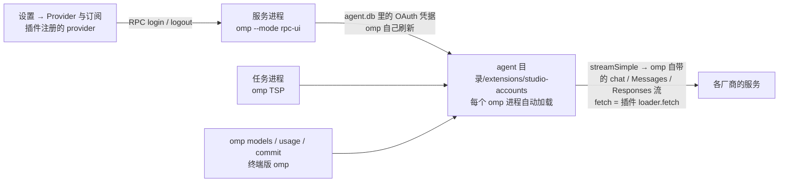

# 内置 magpie 插件：第三方客户端账号

在设置里登录自己的客户端账号（Qoder、WorkBuddy、Trae、Kiro、Zed……），它套餐里的模型出现在模型选择器里，任务直接用。不装 magpie、不依赖 magpie 在跑、不自带它的 exe。

仓库所有者 2026-10-25 选了 omp 扩展路线 + 原样 vendor magpie 社区的 MIT 插件，不做用户自装插件的安装系统。通用宿主（`shim.mjs`）按插件自己的声明注册 provider；内置插件包和注册出的 provider 见第 5 节。

## 0. 结论

**用一个 studio 自带的 omp 扩展实现：studio 把它写进 omp 的扩展目录 `<agent 目录>/extensions/studio-accounts/`，omp 每个进程启动时自动加载。不用本地 HTTP 网关、不写 `models.yml`、不自己存 token。**

| 路线 | 做法 | 判断 |
|---|---|---|
| A 依赖 magpie | 把 magpie 的本地端口当 OpenAI 兼容提供商加进 `models.yml` | 否：要求用户装 magpie 并一直开着，登录、模型、账号都在 magpie 那边 |
| B studio 主进程网关 | 主进程起本地网关 + 自己加密存 token + 写 `providers.<id>` | 否：本地端口、网关密钥、safeStorage 凭据库、`models.yml` 自动写四样新东西都要单独批准和维护 |
| **C omp 扩展** | 扩展里 `pi.registerProvider(id, {api, oauth, fetchDynamicModels, streamSimple, models, usage})`；studio 只放文件 | **采用**：登录走 omp 自己的 OAuth（凭据进 agent.db，和终端版共用、由 omp 加密和刷新），模型进 omp 的模型列表，请求整形全在扩展里 |

C 的代价：随应用发布一份第三方 JS（MIT），并且 studio 要往 `~/.omp` 里写一个目录（[omp-boundaries.md](omp-boundaries.md)「自己写 omp 配置的例外」第 5 项，仓库所有者 2026-10-26 批准）。**为什么是扩展目录而不是 `-e` 加载**：`-e` 只有部分子命令认（见 3.1"加载"），`omp commit` 用不了账号模型；终端版 omp 也看不到这些 provider，studio 把默认模型设成账号模型后终端版会悄悄换成别的模型（实测 omp 18.12.6：不报错，stderr 也没有提示）。放进扩展目录后两边看到的 provider 一样，代价是每个 omp 进程启动多约 0.1 秒（实测：rpc-ui 到 `ready` 中位数 437 → 547 ms）。

## 1. 依据（`@oh-my-pi/pi-coding-agent` / `pi-ai` 18.12.6 源码）

- `ProviderConfigInput`（`src/config/model-registry.ts`）支持 `api`、`streamSimple`、`oauth: {name, login, refreshToken, getApiKey, modifyModels}`、`fetchDynamicModels(apiKey)`、`models[]`、`usage`。
- `registerProvider()`：`streamSimple` + 自定义 `api` → `registerCustomApi()`；`oauth` → 全局 OAuth 注册表；有 oauth 时 `apiKey` 降级为 fallback。
- RPC `get_login_providers` 就是 `getOAuthProviders()` → 扩展注册的 provider 出现在 studio 现有的"连接提供商"列表里，登录方式按未知 provider 当 `oauth` 处理（`src/shared/provider-login.ts` 的默认分支），界面不用改。
- RPC `login`：`onAuth` → `extension_ui_request` 的 `open_url`；`onPrompt`（在 `onAuth` 之后）→ `input`；`onProgress` → `notify`；登录成功后 omp 自己 `refreshProvider(provider, "online")`。**`onPrompt` 带 `secret: true` 在 RPC 模式被直接拒绝**（"Use the terminal UI to log in"），`onAuth` 之前调 `onPrompt` 也被拒。
- `streamOpenAICompletions` 用 `options.fetch ?? fetch`，可从 `@oh-my-pi/pi-ai/providers/register-builtins` 导入。所以 `streamSimple` 只要把插件"接管 fetch"的 loader 塞进 `options.fetch`，SSE、工具调用、思考块、流式错误全交给 omp。
- 扩展目录（`extension-loading.md`；源码 `extensibility/extensions/loader.ts`）：`<agent 目录>/extensions/` 下的 `*.ts` / `*.js` 和带 `index.ts` / `index.js` 的子目录，每个 omp 进程（交互、rpc-ui、`omp commit`、`omp models` 等子命令）启动时都加载；**加载失败会让 omp 启动失败**。

## 2. 架构



- studio 不碰 token：登录、刷新、存取都在 omp 里。
- studio 不写 `models.yml`：provider 是运行时注册的。
- 扩展不是子进程，没有孤儿进程；扩展加载失败会让 omp 起不来，所以部署要先完成、文件要齐。

## 3. 扩展

### 3.1 文件、部署、加载

- 源文件：`src/main/client-accounts/extension/` —— `studio-accounts.mjs`（入口，列出插件模块）、`shim.mjs`（通用宿主）、`adapter.mjs`（纯映射，单测直接 import；`adapter.d.mts` 只给仓库里的 TS，不部署）、`models-cache.mjs`、`vendor/<插件>/`（MIT 原样 vendor）+ `vendor/LICENSE`、`NOTICE.md`（包名、版本、升级步骤）。
- 打包：`deploy.ts` 用 `import.meta.glob(..., { query: "?raw", eager: true })` 把 `extension/` 下文件原文并进主进程 bundle，启动时写到 `<agent 目录>/extensions/studio-accounts/`（agent 目录同 `resolveAgentDir`），另加一个 `index.js` 转出入口（omp 只认目录里的 `index.ts` / `index.js`）。加插件只要放进 `vendor/`、在入口里 import。**不放进 asar**：omp 是另一个进程，读不了 asar；`electron-builder.yml` 的 `files` 因此不用改（[security.md](security.md)「安装包里只有应用本身」）。
- 写入规则（`deploy.ts`，`test/client-accounts-extension.test.ts`）：只写这一个目录；内容没变的文件不碰，变了的原子替换（`writeFileAtomic`：终端里的 omp 可能正在读）；写过的文件清单记在 `.studio-files.json`，下次按清单删掉新版本没有的文件，指向目录外的路径一律忽略；插件自己写的模型缓存不在清单里，不动。
- 时机：`prepareAccountExtension()`（`prepare.ts`）在 `app.whenReady` 里开始，窗口不等它；**起任何子进程之前都要等它**（`platform/spawn-gate.ts` 的 `spawnsReady()`：omp 发现流程、`buildOmpLaunch` / `buildTspLaunch`、`runCommand`、内置终端）。部署失败只记日志，不拦任何功能。
- **加载**：所有 omp 进程和子命令都不带参数，由 omp 自己从扩展目录加载。实测 omp 18.12.6（2026-10-26）：`-e` 只有 `models`、`usage` 认，`stats`、`ssh`、`plugin`、`skill`、`config`、`share`、`commit`、`auth` 报 `Unknown option '-e'` 退出 1——给所有子命令统一加 `-e` 会让设置页的 SSH、插件、Skills、用量统计、分享、"生成提交信息"全部失败。
- 入口另外装上 Tavily 备用 key 的 `fetch` 包装（`tavily-keys.mjs`），见 `login.md`「Tavily 备用 key」；带 `STUDIO_BROWSER_CDP` 的进程（studio 起的 TSP 任务）把 `browser.cdpUrl` 在内存里指到任务的浏览器面板（`studio-browser.mjs`，用户自己配了就不动），见 `browser.md`。
- 卸载：Windows 安装器的 `customUnInstall`（`resources/installer.nsh`）在目录里有 `.studio-files.json` 时删掉整个 `studio-accounts/`；更新（`--updated`）时不删。agent 目录按卸载程序的环境变量算，和运行时不一致时删不到 [推测：只有自己改过 `PI_CODING_AGENT_DIR` / `PI_CONFIG_DIR` 的用户会遇到]。mac 没有卸载程序，目录留着。
- `vendor/` 原样保留：加进 `.prettierignore` 和 `.oxlintrc.json` 的 `ignorePatterns`，方便和上游 diff。

### 3.2 每个 provider 注册成什么

`shim.mjs` 的 `registerPluginProviders`：每个插件模块里的每个 `*Plugin` 导出（或 OpenCode v1 的 `{ id, server }`）跑一次 `make({ client })`，从返回的钩子里读：

- `auth.provider` → provider id；omp 自己已有这个 id 时（`getProviderDefinition(id)`，如 `minimax-code`）注册成 `<id>-account`，不覆盖 omp 的；交给插件的地方仍用插件自己的 id。
- `config(cfg)` 写的 `cfg.provider[id]` → 名字、默认地址、静态模型表。
- `auth.methods` → 登录方式（`adapter.mjs` 的 `pickSignInMethod`）：浏览器 / 设备流 / 不需要输入的 api 方式；只有 select 提示的取第一个选项。要打字输入的（PAT、手机号、企业域名）RPC 登录收不到，这样的 provider 不注册。
- 每个模型的 `api.npm` → 传输：`@ai-sdk/openai-compatible` → `openai-completions`，`@ai-sdk/anthropic` → `anthropic-messages`，`@ai-sdk/openai` → `openai-responses`，别的不收；`api.url` → 模型行的 `baseUrl`。标了 `decides: true` 的"决策模型"（请求体不是对话）也不收。

```js
pi.registerProvider(id, {
  api: `studio-${id}`,                  // 扩展自有 api（内置名保留），streamSimple 由我们实现
  baseUrl: providerUrl,                 // 插件 config 里的地址；每个模型行另带自己的 baseUrl
  models: cachedRows,                   // 上一次的账号模型列表（冷启动用）
  oauth: { name, login, refreshToken, getApiKey },
  async fetchDynamicModels() { /* 插件 provider.models({auth}) → modelRow → omp 的模型行 */ },
  streamSimple(model, context, options) {
    const transport = transports.get(model.id);        // chat / messages / responses
    return STREAMS[transport].stream(wireModel(model, transport), context, {
      ...options,
      fetch: fetchVia(model, transport, options?.sessionId),  // 插件 loader.fetch；没有 fetch 的插件自己带 Bearer 发
    });
  },
});
```

坑和对策（单测在 `test/client-accounts-adapter.test.ts`）：

- `wireModel`：omp 交给 `streamSimple` 的模型按自定义 api 建，`compat` 是空的，直接交给 Messages / Responses 流会报 `undefined is not an object (evaluating 'e.compat....')`。所以按真正的传输用 `@oh-my-pi/pi-catalog/build` 的 `buildModel` 重建（omp 的 factory-droid 也这样做）。
- Messages 的地址：omp 的 anthropic 流请求 `<站点>/v1/messages`（去掉 baseUrl 末尾的 `/v1` 再拼），插件认的是 `<api.url>/messages`，`pluginUrl` 改写成后者。
- 只给 key 不给 fetch 的插件：宿主自己带 `authorization: Bearer` 和插件的头发请求。只给 key 的 api 凭据存进 omp 时记成 `access = key`、`studioCredential: "api"`、不过期（omp 就不去刷），交还插件时还原。
- **凭据两个方向各管一头**：omp 把 OAuth 凭据整段 JSON 存（`serializeCredential` 只摘 `type`），插件的 `uid`、`machineId` 等字段能原样往返。存进 omp 时摘掉插件自己的 `type:"success"`（`normalizeCredential`，否则 `type` 被覆盖成非法值）；交给插件时补回 `type:"oauth"`（`toPluginAuth`：插件 loader 第一句就是 `if (auth?.type !== "oauth") return {}`，少了它任务里报 `the bundled plugin returned no fetch`；2026-10-25 实测踩过）。
- **refresh 只有一个发起人**：Qoder 的 refresh token 一次性，两边都刷就要重新登录。有 `auth.refresh` 的插件，喂给它的凭据用 `stretchExpiry` 推后到期（插件就不自己刷），真正刷新由 omp 调 `refreshToken`；没有 `auth.refresh` 的插件自己续。插件续了凭据时调 `client.auth.set`，宿主 `mergeCredential` 叠到当前凭据上并 `upsertOAuth` 存回。
- **`getAvailable()` 不走 `oauth.modifyModels`**（实测：钩子一次都没调），模型行只来自注册时的静态 `models` 和 `fetchDynamicModels`。
- **冷启动没有发现**：omp 的发现是 `online-if-uncached` + 24 小时 SQLite 缓存，新进程不会替我们拉，一次失败还会把空列表当权威结果缓存 24 小时。所以扩展自己：① 注册时用 `models-cache.mjs` 的上一次结果当静态 `models`；② `session_start` 时用 `discoverAuthStorage().credentials.getOAuth(id)` 读已登录账号，拉一次列表，成功才写缓存并重新注册（间隔 `CATALOG_TTL_MS`，免得每个任务进程都拉）；③ `fetchDynamicModels` 拿不到凭据或拿到空列表时**抛错**，不让"空"进缓存。
- 账号的模型 id 和插件静态表完全不同（Qoder CN 实测 10 个，没一个在静态表里），所以不能只用静态表。
- WorkBuddy 的 chat 在 `<endpoint>/v2`：模型行必须带插件给的 `api.url` 作 `baseUrl`，否则 omp 打到 `<endpoint>/chat/completions`——**回 200 但没有可用回答**，重试 12 次后空回复（2026-10-25 实测）。
- `getApiKey` 每次请求前都被 omp 调（`pi-ai` 的 `auth/select.ts`），所以它同时是"把 omp 手里最新的凭据同步进扩展"的钩子。
- 会话 id：`options.sessionId` 经插件的 `chat.headers` 变成它要的头（Qoder 的 `x-magpie-qoder-session`，不会发给厂商）；没填时插件按首条用户消息自己哈希。
- **额度**：插件有 `auth.usage` 时注册带 `usage: { id, fetchUsage }`，`omp usage`（studio 的用量对话框读它）替这个账号查额度。omp 交给 `fetchUsage` 的凭据只有标准字段，插件要的设备 id 等没有，所以按 access token 在 `discoverAuthStorage().credentials.list(id)` 里找回整条。插件结果按 magpie 的契约（`internal/plugin/host.js` 的 `usageOf`）经 `adapter.mjs` 的 `usageReport` 换成 omp 的 `UsageReport`，字段映射以代码和单测为准。`until` / `renew` 映射到 studio 自己约定的 `metadata.planEndsAt` / `autoRenew`，omp 没有对应字段，终端 `omp usage` 不显示，只有 studio 的 `parseQuota` 读。还没接：窗口里的 `runsOutAt` / `runsOut`、`resets` 的 `team`。真实账号实测过的只有 qoder-cn、workbuddy、trae-cn、opencode-zen-free（第 10 节）；到期、续费、重置三项用假 provider 经真实 omp 18.12.6 跑过。

### 3.3 与插件的接缝

插件是 magpie/OpenCode 形状：`makePlugin(site)({client})` 返回 `auth.methods / auth.refresh / auth.loader / provider.models / chat.headers / usage / checkin`。扩展只做 **host shim**：实现 `client.auth.set`、把 `auth.loader(getAuth).fetch` 接进 `streamSimple`、`usage` 接进 omp 的用量；`checkin` 没接。**不重写协议**：签名信封、body codec、工具名往返是上游踩过坑的地方，重写等于把上游的修复再做一遍。shim 只依赖 `shim.mjs` 文件头列出的几个钩子。

版本策略：`NOTICE.md` 记包版本 + commit 和升级步骤；升级只换 vendor 文件并跑测试（第 7 节）。不引 npm 依赖（插件是零依赖 ESM）。

## 4. studio 侧接线

- `deploy.ts` / `prepare.ts`：见 3.1。启动参数（`buildOmpArgs` / `buildTspArgs`）和 `runOmpCommand` 都不加扩展参数。
- 界面：**不改**。provider 出现在 `get_login_providers` 里，走现有 `ProviderPickDialog` → `ProviderFlowDialog`；登录后 omp 自己 `refreshProvider`，studio 照旧作废缓存的模型目录，下次现读（`account-handlers.ts` 的 `startLogin` → `startupCache().forgetCatalog()`；终端登录是另一个进程写的凭据，再用 `reloadServiceModels` 关掉服务进程）。
- 退出登录：现有 `logout` UI，凭据从 agent.db 删掉；模型随进程重启消失。
- `src/shared/provider-login.ts` 不列这些 id，走"按 `oauth` 处理"的默认分支；`shared/provider-keys.ts` 也不列，所以没有"设置 API key"。
- i18n：provider 名字由扩展的 `oauth.name` 给，studio 不翻；登录对话框里 omp 给的提示是英文。

## 5. 注册出来的 provider

`STUDIO_REAL_OMP=1` 的真实 omp 测试核对这张表（id、名字、登录方式都来自插件自己的声明；包名和版本见 `NOTICE.md`）：

| 插件 | provider |
|---|---|
| qoder | `qoder`、`qoder-cn`、`qwenwork`（PAT 登录不接） |
| workbuddy | `workbuddy`、`workbuddy-ai`（"读桌面版登录"不接） |
| trae | `trae-cn`、`trae-global` |
| kiro | `kiro` |
| zed | `zed` |
| commandcode | `commandcode-plan` |
| minimax | `minimax-code-account`（omp 已有 `minimax-code`，换名）、`minimax-code-global` |
| mimo | `mimo-app` |
| zcode | `zcode` |
| codearts | `codearts` |
| opendesign | `opendesign` |
| joycode | `joycode` |
| raccoon | `raccoon` |
| nous | `nous-portal` |
| autoclaw | `autoclaw`（登录时的 Google / z.ai 选择取第一个） |
| zen-free | `opencode-zen-free`（不用账号，公共 key） |

不接的：`qwenwork-enterprise`（要输企业域名）、`autoclaw-cn`（要手机号）；没 vendor 的：cloudflare-workers-ai（要输 API token）、gcp-ai（读 gcloud 的登录）、cursor / devin / factory / cline / grok（omp 已原生支持）、kimi-work / kimi-desktop（读桌面版的登录）、agent / 中间件类插件。

各厂商的协议细节都在插件里，宿主不认具体厂商；被厂商拒绝（如 WorkBuddy 的 11128 渠道不认、11140 账号受限）时原样报错。

明确不做：读 Qoder / WorkBuddy 桌面版已登录的凭据（越界，而且 WorkBuddy 5.6 之后那个文件加密）；多账号轮换、路由组、failover（omp 这边是"选一个凭据"）；隐私 masking、转发站导入、配额看板。

## 6. 决定

| # | 决定 | 结论 |
|---|---|---|
| D1 | 路线 | **C omp 扩展**（仓库所有者 2026-10-25） |
| D2 | 登录方式范围 | 只暴露不用打字的登录：`pickSignInMethod` 只挑这些，PAT、手机号、域名的实现留在插件里不暴露（RPC 拒绝 secret 输入） |
| D3 | vendor 第三方 MIT 代码并随应用发布 | **批准**（仓库所有者 2026-10-25），不自己重写协议；来源和哈希记在 `NOTICE.md`，vendor 不 lint/format |
| D4 | 渠道风险告知（"非官方客户端，可能被厂商限制/封号"） | 未做：没有自己的登录对话框，文案得放进 `ProviderFlowDialog` 或登录前的确认步骤 |
| D5 | 覆盖范围 | **magpie 社区全部能登录的账号插件**（仓库所有者 2026-10-25："都加上吧"），见第 5 节 |
| D6 | 关闭开关（设置 → 高级） | 未做；要做时做成"删掉扩展目录"，别的功能不受影响 |
| D7 | 冒烟账号 | 仓库所有者提供了 Qoder CN、WorkBuddy、Trae CN；其余没有账号 |

## 7. 测试

- `test/client-accounts-adapter.test.ts`：插件导出识别、`pickSignInMethod`、凭据往返和刷新叠加、交给插件的凭据、模型行和传输选择、Messages 地址改写、额度映射。
- `test/client-accounts-cache.test.ts`：模型列表缓存不串 provider、不写 token。
- `test/client-accounts-extension.test.ts`：部署出去的每个相对 import 都在文件表里（少一个文件 omp 就整个扩展加载失败）、带空格和中文的 agent 目录、写入规则。
- `test/client-accounts-real-omp.test.ts`（`STUDIO_REAL_OMP=1`，PATH 上有 omp）：不带参数的 omp 的 `get_login_providers` 里是第 5 节的 provider、要打字登录的不出现、重名的换名；再跑一轮真实模型 `-p`（`.env` 的 `STUDIO_TEST_MODEL`），确认扩展不影响别的 provider。
- 还没写：本地假厂商服务（登录轮询、模型列表、SSE chat、401 → 刷新 → 重试）；e2e（设置里出现 provider → 登录 → 模型 → 发 prompt → 退出后消失）。

## 8. 风险

- **账号风险**：请求带客户端自己的请求头和签名（Qoder 的 COSY、WorkBuddy 的 `X-IDE-*`），本质是冒充官方客户端；WorkBuddy 出现过 11140 限制（[magpie#1849](https://github.com/yetone/magpie/issues/1849)）。所以 D4 的告知不是形式。
- **扩展 API 不在 wire schema 里**：`registerProvider` 的 `oauth` / `streamSimple` 是 omp 的扩展 API，omp 升级可能改，会以启动失败或登录失败暴露；升级 omp 后跑真实 omp 测试。
- **vendor 代码漂移**：上游修 bug 要手动升，见 `NOTICE.md`。
- **vendor 代码的副作用**：`child_process`（读客户端装的机器 id）、`fs` 读自己的目录、Trae / AutoClaw 登录时在 `127.0.0.1` 临时起回调端口。AutoClaw 把额度记账写在 `$XDG_CONFIG_HOME` 或 `$HOME` 下的 `magpie/`，Windows 上两个变量一般都没有，会写到当前盘根目录；入口在两个都没设时把 `AUTOCLAW_USAGE_STATE_FILE` 指到家目录（`studio-accounts.mjs`）。
- **agent.db 里的凭据和终端版共用**：终端里 `logout` 也会让 studio 这边掉线（预期行为）。
- **扩展加载失败 = omp 起不来**：文件写坏、被杀软拦、版本不匹配。退路是部署测试和 D6 的开关。

## 9. 还没验证的

- 真实账号：Qoder CN、WorkBuddy、OpenCode Zen 免费档走通了登录 → 模型 → 对话；其余 provider 没有账号，只验证了注册、登录列表和宿主的三种传输（假插件）。带工具的多轮、到期 / 401 后自动刷新、退出登录后模型消失都没实测。
- 登录取消：`raceAbort` 让 login 立刻失败，但插件自己的轮询会继续到它的上限，只有关掉服务进程才真的停。
- 应用内的界面没有实际启动看过（RPC 层已实测）。
- omp 会不会在任务里传 `options.sessionId`（决定 Qoder 的 prompt cache 命中）。

## 10. 实测记录（omp 18.12.6，2026-10-25 起）

方法：一次性的假 provider 扩展（不联网）+ 真实 omp 的 `--mode rpc-ui`，以及部署出来的真扩展。

| 验证点 | 结果 |
|---|---|
| 扩展目录加载 | 不带参数的 `omp models`、rpc-ui、`omp commit` 都能看到这些 provider |
| `import ... from "@oh-my-pi/pi-ai/providers/register-builtins"` | 能解析（`./providers/*` 子路径导出） |
| `get_login_providers` 里出现扩展注册的 provider | 通过（`name` 来自 `oauth.name`；没有账号时加载不报错、不打日志） |
| RPC `login`：`onAuth` → `open_url`，`onProgress` → `notify`，`onPrompt` → `input` | 通过 |
| 登录后凭据进 agent.db，`get_logout_accounts` 看到一条 `type: oauth` | 通过（标签取 `accountId`） |
| 登录后 omp 自己调 `fetchDynamicModels(apiKey)` | 通过，参数是 `getApiKey` 的返回值 |
| `getApiKey(credentials)` 每次请求前被调 | 通过（请求解析 + 真正发请求各一次） |
| `streamSimple` 里把插件 fetch 塞进 `options.fetch` | 通过：omp 正常解析 SSE |
| 扩展会不会连累别的 provider | 不会：带扩展跑真实模型正常，stderr 没有扩展日志 |
| `oauth.modifyModels` 能否在 `getAvailable()` 里补模型行 | **不能**：钩子一次都没被调 |
| 扩展里 `discoverAuthStorage().credentials.getOAuth(id)` | 能读到 access / uid / machineId / refresh |
| 真实账号一轮对话：`qoder-cn/fast`、`workbuddy/deepseek-v4-pro` | 通过（WorkBuddy 要 `<endpoint>/v2` 的 `baseUrl`，见 3.2） |
| 冷启动用缓存注册静态行 | 通过（第二次启动立刻有模型，随后会话里刷新） |
| 空列表被当权威缓存 24 小时 | 踩过：一次失败的发现把 provider 固定成 0 个模型，重启也不恢复；所以空结果抛错 |
| OpenCode Zen 免费档：api 方式登录（不开浏览器）→ 模型 → 对话 | 通过 |
| Messages / Responses 传输（假插件） | 通过；踩过 `compat` 为空和 Messages 地址两处（见 3.2） |
| 账号额度（2026-10-26，`omp usage --json`） | qoder-cn、workbuddy、trae-cn 出现在 `reports` 里，`parseQuota` 解析出剩余百分比和重置时间；opencode-zen-free 只有套餐 |
| 插件升到 2026-10-30 版本后，omp 18.14.0 | 真实 omp 测试通过；zen-free `deepseek-v4.1-flash-free` 让模型调 bash 一轮通过。zen-free 0.1.15 读不到目录时上下文窗口给 32768，长对话一切到它就要先压缩；0.1.18 按实测下限给 |
