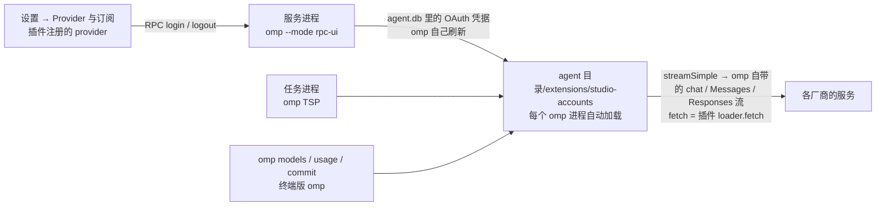

# 内置 magpie 插件：第三方客户端账号

目标：把 magpie 那套"本地代理 + 账号"的能力搬进 studio —— 在设置里登录自己的客户端账号（Qoder、WorkBuddy、Trae、Kiro、Zed……），它套餐里的模型出现在模型选择器里，任务直接用。不装 magpie、不依赖 magpie 在跑、不自带它的 exe。

状态：仓库所有者 2026-10-25 提出并选了 omp 扩展路线 + 内置 magpie 社区的 MIT 插件（原样 vendor，不做用户自装插件的安装系统）。**已实现**：通用宿主（`shim.mjs`）按插件自己的声明注册 provider，内置 16 个插件包、注册出 21 个 provider（第 5 节）；Qoder CN 和 WorkBuddy 用仓库所有者的真实账号走通了登录 → 模型列表 → 一轮对话，OpenCode Zen 免费档（不用账号）走通了登录 → 模型 → 对话（第 11 节）。

## 0. 结论

**用一个 studio 自带的 omp 扩展实现：studio 把它写进 omp 的扩展目录 `<agent 目录>/extensions/studio-accounts/`，omp 每个进程启动时自动加载。不用本地 HTTP 网关、不写 `models.yml`、不自己存 token。**

| 路线 | 做法 | 判断 |
|---|---|---|
| A 依赖 magpie | studio 把 `http://127.0.0.1:3425/v1` 当普通 OpenAI 兼容提供商加进 `models.yml` | 否：要求用户装 magpie 并一直开着；登录、模型列表、账号都在 magpie 那边，studio 只是个壳；magpie 不在跑时模型不可用；和"studio 自带这个功能"相反 |
| B studio 主进程网关 | 主进程起 `127.0.0.1:<port>` 网关 + 自己加密存 token + 写 `providers.<id>` | 能实现，但四样新东西（本地端口、网关密钥、safeStorage 凭据库、`models.yml` 的自动写）都要单独批准和维护；omp 侧全靠 `openai-completions` 反推 |
| **C omp 扩展** | 扩展里 `pi.registerProvider(id, {api, oauth, fetchDynamicModels, streamSimple, models, usage})`；studio 只负责把扩展文件放进 omp 的扩展目录 | **推荐**：端口、网关密钥、凭据库、`models.yml` 全不需要；登录走 omp 自己的 OAuth（凭据进 agent.db，和终端版共用、由 omp 加密和刷新）；模型进 omp 的模型列表；请求整形全部在扩展里 |

C 的代价：多一份随应用发布的第三方 JS（MIT），并且 studio 要往 `~/.omp` 里写一个目录（AGENTS.md「omp 的边界」的例外，仓库所有者 2026-10-26 批准）。0.4.24–0.4.27 是写在 userData、每个 omp 进程传 `-e`，这些 provider 只在 studio 起的 omp 里有；结果 `omp commit` 不认 `-e`（生成提交信息用不了账号模型），终端版 omp 也看不到，studio 把默认模型设成账号模型后，终端版会悄悄换成别的模型（实测 omp 18.12.6：不报错，stderr 也没有提示）。放进扩展目录后两边看到的 provider 一样，每个 omp 进程启动多约 0.1 秒（实测：rpc-ui 到 `ready` 中位数 437 → 547 ms，和 `-e` 一样）。

## 1. 依据（npm 上的 `@oh-my-pi/pi-coding-agent` / `pi-ai` 18.12.6 源码；还没跑）

- `ProviderConfigInput`（`src/config/model-registry.ts`）支持 `api`、`streamSimple`、`oauth: {name, login, refreshToken, getApiKey, modifyModels}`、`fetchDynamicModels(apiKey)`、`models[]`、`usage`。
- `registerProvider()` 里：`streamSimple` + 自定义 `api` → `registerCustomApi()`；`oauth` → `registerOAuthProvider()`（进全局 OAuth 注册表）；`apiKey` 在有 oauth 时降级为 fallback（登录的凭据优先）。
- RPC `get_login_providers` 就是 `getOAuthProviders()`（`modes/rpc/rpc-mode.ts`）→ 扩展注册的 provider 会出现在 studio 现有的"连接提供商"列表里，登录方式按未知 provider 当 `oauth` 处理（`src/shared/provider-login.ts` 的默认分支），界面不用改。
- RPC `login`：`onAuth` → `extension_ui_request` 的 `open_url`；`onPrompt`（在 `onAuth` 之后）→ `input`；`onProgress` → `notify`；登录成功后 omp 自己跑 `refreshProvider(provider, "online")` 重新发现模型。**`onPrompt` 带 `secret: true` 在 RPC 模式被直接拒绝**（"Use the terminal UI to log in"），`onAuth` 之前调 `onPrompt` 也被拒。
- `streamOpenAICompletions(model, context, options)` 用 `options.fetch ?? fetch`（`providers/openai-completions.ts`），可以从 `@oh-my-pi/pi-ai/providers/register-builtins` 导入（包的 `./providers/*` 子路径导出）。所以扩展的 `streamSimple` 只要把插件那个"接管 fetch"的 loader 塞进 `options.fetch`，SSE、工具调用、思考块、流式错误全交给 omp。
- 扩展目录（`extension-loading.md`；omp 18.12.6 源码 `extensibility/extensions/loader.ts`）：`<agent 目录>/extensions/` 下的 `*.ts` / `*.js` 文件和带 `index.ts` / `index.js` 的子目录，每个 omp 进程（交互、rpc-ui、`omp commit`、`omp models` 等子命令）启动时都加载；加载失败会让 omp 启动失败（所以要先确认文件在位）。`--extension <path>` / `-e` 也能加载，但只有部分子命令认（见 3.1）。

## 2. 架构



- studio 不碰 token：登录、刷新、存取都在 omp 里（AGENTS.md「omp 的边界」不用加例外）。
- studio 不写 `models.yml`：provider 是运行时注册的。
- 扩展不是子进程，没有孤儿进程；扩展加载失败会让 omp 起不来，所以部署和参数都要先校验。

## 3. 扩展

### 3.1 文件、部署、加载

- 源文件（相对 studio 仓库）：`src/main/client-accounts/extension/` —— `studio-accounts.mjs`（入口，列出要加载的插件模块）+ `shim.mjs`（通用宿主：插件 → `pi.registerProvider`）+ `adapter.mjs`（纯映射，能被单测直接 import）+ `adapter.d.mts`（它的类型声明，只给仓库里的 TS 用，不部署）+ `models-cache.mjs` + `vendor/<插件>/`（MIT，原样 vendor）+ `vendor/LICENSE`（magpie 社区仓库的 MIT 全文）+ `NOTICE.md`（每个插件的包名、版本、更新步骤）。
- 打包：`deploy.ts` 用 `import.meta.glob(..., { query: "?raw", eager: true })` 把 `extension/` 下全部文件（`.d.mts` 除外）的原文并进主进程 bundle，启动时写到 `<agent 目录>/extensions/studio-accounts/`（agent 目录同 `resolveAgentDir`：`PI_CODING_AGENT_DIR`，否则 `<家目录>/<PI_CONFIG_DIR 或 .omp>/agent`），另加一个 `index.js`（`export { default } from "./studio-accounts.mjs"`：omp 只认目录里的 `index.ts` / `index.js`）。加插件只要把文件放进 `vendor/`、在入口里 import，不用改部署表。**不放进 asar**：omp 是另一个进程，读不了 asar。这样 `electron-builder.yml` 的 `files` 不用改（AGENTS.md「安装包里只有应用本身」）。
- 写入规则：只写这一个目录。全部文件并行读出来比较，内容一样的文件不碰，变了的先写临时文件再换名（`tasks/atomic-write.ts` 的 `writeFileAtomic`，Windows 上换名遇到短暂占用会重试；终端里的 omp 可能正在读）；写过的文件清单记在 `.studio-files.json`（清单没变就不重写），下次启动按清单删掉新版本没有的文件，清单里指向目录外的路径一律忽略；插件自己写的模型缓存（`models-cache-v3.json`）不在清单里，不动。启动时 `prepareAccountExtension()`（`prepare.ts`）部署一次：窗口不等它，和窗口同时开始；起任何子进程之前都要等它做完（`platform/spawn-gate.ts` 的 `spawnsReady()`：omp 发现流程、`buildOmpLaunch` / `buildTspLaunch`、`runCommand`、内置终端）。部署失败只记日志，不拦任何功能。顺带删掉 0.4.24–0.4.27 写在 `userData/omp-extensions/` 的旧部署。
- 加载：所有 omp 进程和子命令都不带参数，由 omp 自己从扩展目录加载。实测 omp 18.12.6（2026-10-26）：`-e` 只有 `models`、`usage` 认，`stats`、`ssh`、`plugin`、`skill`、`config`、`share`、`commit`、`auth` 报 `Unknown option '-e'` 退出 1（0.4.24–0.4.27 曾在 `runOmpCommand` 里给所有子命令都加，设置页的 SSH、插件、Skills、用量统计、分享会话、"生成提交信息"全都失败）；扩展目录对这些子命令都有效。
- 入口另外装上 Tavily 备用 key 的 `fetch` 包装（`tavily-keys.mjs`，读同目录不在清单里的 `tavily-keys.json`；换上的 key 写进 agent 目录 `.env` 的 `TAVILY_API_KEY`），见 `docs/architecture/login.md`「Tavily 备用 key」。
- 入口还会在进程带 `STUDIO_BROWSER_CDP` 时（studio 起的 TSP 任务）把这个进程的 `browser.cdpUrl` 在内存里指到任务的浏览器面板（`studio-browser.mjs`，用户自己配了就不动），见 `docs/architecture/browser.md`。
- 卸载：Windows 安装器的 `customUnInstall`（`resources/installer.nsh`）在目录里有 `.studio-files.json` 时删掉整个 `studio-accounts/`；更新（`--updated`）时旧版本的卸载程序也会跑，这时不删。agent 目录按卸载程序的环境变量算（`PI_CODING_AGENT_DIR` / `PI_CONFIG_DIR`），和 studio 运行时看到的不一致时删不到 [推测：只有自己改过这两个变量的用户会遇到]。mac 没有卸载程序，拖进废纸篓后目录留着。
- `vendor/` 原样保留：加进 `.prettierignore` 和 `.oxlintrc.json` 的 `ignorePatterns`，不格式化也不 lint，方便和上游 diff。

### 3.2 每个 provider 注册成什么

实际代码（`shim.mjs` 的 `registerPluginProviders`）：入口把每个插件模块交进来，模块里每个 `*Plugin` 导出（`makePlugin(site)` 的产物，或 OpenCode v1 的 `{ id, server }`）跑一次 `make({ client })`，从返回的钩子里读：

- `auth.provider` → provider id；omp 自己已有这个 id 时（`getProviderDefinition(id)`，如 `minimax-code` 是 omp 的 MiniMax Coding Plan key）注册成 `<id>-account`，不覆盖 omp 的；交给插件的地方（`config`、`chat.headers`）仍用插件自己的 id。
- `config(cfg)` 写的 `cfg.provider[id]` → 名字、默认 npm、默认地址、静态模型表。
- `auth.methods` → 登录方式（`pickSignInMethod`）：浏览器 / 设备流 / 不需要输入的 api 方式（如 OpenCode Zen 的公共 key）；只有 select 提示的取第一个选项。要打字输入的（PAT、手机号、企业域名）RPC 登录收不到，这样的 provider 不注册。
- 每个模型的 `api.npm` → 传输：`@ai-sdk/openai-compatible` → omp 的 `openai-completions`，`@ai-sdk/anthropic` → `anthropic-messages`，`@ai-sdk/openai` → `openai-responses`；别的（如 `@ai-sdk/google`）不收。`api.url` → 模型行的 `baseUrl`。标了 `decides: true` 的模型（magpie 的"决策模型"，如 Command Code 0.1.19 的 Jev：请求体是 `{state, questions}`，不是对话）也不收（`modelRow` 返回 null）。

```js
pi.registerProvider(id, {
  api: `studio-${id}`,                  // 扩展自有 api（内置名保留），streamSimple 由我们实现
  baseUrl: providerUrl,                 // 插件 config 里的地址；每个模型行另带自己的 baseUrl
  models: cachedRows,                   // 上一次的账号模型列表（冷启动用）
  oauth: { name, login, refreshToken, getApiKey },
  async fetchDynamicModels() { /* 插件 provider.models({auth}) → modelRow → omp 的模型行 */ },
  streamSimple(model, context, options) {
    const transport = transports.get(model.id);        // chat / messages / responses
    return STREAMS[transport].stream(wireModel(model, transport), context, {
      ...options,
      fetch: fetchVia(model, transport, options?.sessionId),  // 插件 loader.fetch；没有 fetch 的插件自己带 Bearer 发
    });
  },
});
```

- `wireModel`：omp 交给 `streamSimple` 的模型是按自定义 api 建的，`compat`（各传输按模型查的兼容开关）是空的，直接交给 Messages / Responses 流会报 `undefined is not an object (evaluating 'e.compat....')`。所以按真正的传输用 `@oh-my-pi/pi-catalog/build` 的 `buildModel` 重建一次（omp 的 factory-droid 也这样做），每个模型对象缓存一份。
- Messages 的地址：omp 的 anthropic 流请求 `<站点>/v1/messages`（它会去掉 baseUrl 末尾的 `/v1` 再拼），插件照 `@ai-sdk/anthropic` 认的是 `<api.url>/messages`，`pluginUrl` 改写成后者（保留查询串）。chat / Responses 两边拼法一样，原样转。
- 只给 key 不给 fetch 的插件（loader 返回 `{ apiKey, headers }`）：宿主自己带 `authorization: Bearer` 和插件的头发请求。
- 只给 key 的 api 凭据（OpenCode 的 `{type:"api", key}`）存进 omp 时记成 `access = key`、`studioCredential: "api"`、不过期（omp 就不会去刷它），交还插件时还原。
- 凭据原样存：omp 的凭据库把 OAuth 凭据当 JSON 整段存（`serializeCredential` 只摘 `type`），所以插件凭据里的 `uid`、`machineId`、`deviceToken`、`pat`、`deviceChat`、`vpc` 都能原样往返，不需要拆进 `accountId`。**两个方向各管一头**：存进 omp 时摘掉插件自己的 `type:"success"`（`normalizeCredential`，omp 写的是 `{type:"oauth", ...结果}`，`type` 在后、不改就会被覆盖成非法值）；交给插件时再补回 `type:"oauth"`（`toPluginAuth`，插件的 `auth.loader(getAuth)` 第一句就是 `if (auth?.type !== "oauth") return {}`，少了它任务里会报 `the bundled plugin returned no fetch`）。2026-10-25 实测踩过：登录、模型列表都正常，第一条消息就报这个错。
- refresh 只有一个发起人：Qoder 的 refresh token 一次性，插件自己会在到期前 5 分钟刷。有 `auth.refresh` 的插件，喂给它的凭据用 `stretchExpiry` 把 `expires` 推到至少一天后（插件就不自己刷），真正刷新由 omp 调 `refreshToken`；没有 `auth.refresh` 的插件按原到期时间自己续。插件自己续了凭据时调 `client.auth.set`，宿主把它叠到当前凭据上（`mergeCredential`，刷新结果多半只有变了的字段）并 `upsertOAuth` 存回 omp 的凭据库。
- 模型行的来源只有两处：注册时的静态 `models`，和 `fetchDynamicModels` 的发现结果。**`getAvailable()` 不走 `oauth.modifyModels`**（实测：钩子里的日志一次都没出现），所以"只靠投影时补行"是看不见的。
- 冷启动没有发现：omp 的发现是 `online-if-uncached` + 24 小时 SQLite 缓存，新进程不会替我们拉；之前一次失败还会把"空列表"当权威结果缓存 24 小时。所以扩展自己做三件事（`shim.mjs`）：
  1. 注册时用 `models-cache-v3.json`（扩展自己目录里、只存模型元数据，行里带 `transport`）的上一次结果当静态 `models`——冷启动就有列表；
  2. `session_start` 时用 `discoverAuthStorage().credentials.getOAuth(id)` 读 omp 凭据库里的账号（实测能拿到 `access`/`uid`/`machineId`/`refresh`），拉一次账号列表，成功才写缓存并 `pi.registerProvider` 重新注册（6 小时一次，避免每个任务进程都拉）；
  3. `fetchDynamicModels` 拿不到凭据或拿到空列表时**抛错**，不让"空"进 24 小时缓存。
- WorkBuddy 的 chat 在 `<endpoint>/v2`：插件给每个模型的 `api.url` 就是它，模型行带上作为 `baseUrl`，否则 omp 会打到 `<endpoint>/chat/completions`——**回 200 但没有可用回答**，omp 连发 12 次重试后空回复（2026-10-25 实测）。
- 账号列表一次实测（Qoder CN）：10 个（fast、qwen3.8-max、deepseek-v4-pro、glm-5.3、kimi-k3、minimax-m3…），和插件静态表里的 id 完全不同——这就是不能用静态表的原因。
- `getApiKey` 是每次请求解析凭据时被 omp 调用（`pi-ai` 的 `auth/select.ts` 用 `customProvider.getApiKey(credentials)`，实测每次请求前都会调），所以它同时是"把 omp 手里最新的凭据同步进扩展"的钩子。
- 会话 id：`options.sessionId` 经插件的 `chat.headers` 钩子变成它要的头（Qoder 的 `x-magpie-qoder-session`，插件读它算 `session_id`，这个头不会发给厂商）。没填时插件按首条用户消息自己哈希，功能不受影响。
- 额度（2026-10-26）：插件有 `auth.usage` 时注册带 `usage: { id, fetchUsage }`，`omp usage`（studio 的用量对话框读它）就会替这个账号查额度。omp 交给 `fetchUsage` 的 `params.credential` 是 `buildUsageCredential` 摘出来的标准字段（access / refresh / 到期 / accountId…），插件要的设备 id、套餐之类没有，所以按 access token 在 `discoverAuthStorage().credentials.list(id)` 里找回整条（库里只有一个账号、token 刚被 omp 刷新时把新 token 叠上去）。插件的结果按 magpie 的契约（`internal/plugin/host.js` 的 `usageOf`）经 `adapter.mjs` 的 `usageReport` 换成 omp 的 `UsageReport`：每个 `windows[]` 一条 limit；有 `amount` / `limit` 时按次数算（单位 credits 等保留），只有 `used` 时按百分比，都没有时比例空着、`display` 放进说明（没有 `display` 时放窗口的 `balance` + `unit`：AutoClaw 0.2.13 的"积分余额"窗口只给这两个）；`resetsAt`（ISO 或时间戳）/ `resetSecs` → 重置时间，`span` → 窗口长度；`aside` 的窗口（用完也不挡账号）用完时标 warning 不标 exhausted；`plan` → `metadata.planType`（对话框里的套餐徽标），`user` 是邮箱才放 `metadata.email`；`balance`（按量付费账号的余额，MiniMax、AutoClaw、Raccoon、JoyCode、ZCode、Command Code、OpenDesign 会给）→ 报告的说明 `Balance: …`，只有余额没有窗口也算取到了；`until`（套餐到期 / 下次续费，Command Code、MiniMax、Raccoon、ZCode 会给）→ `metadata.planEndsAt`（毫秒），`renew`（`"auto"` / `"off"`，Command Code、MiMo、ZCode 会给）→ `metadata.autoRenew`，这两个 omp 没有对应字段，终端的 `omp usage` 不显示，只有 studio 的 `parseQuota` 读（对话框里账号下面一行"某日到期 · 不自动续费"）；`resets`（攒下的额度重置，ZCode 会给）→ omp 的 `resetCredits`（每次重置一条明细，带窗口名和到期时间），终端 `omp usage` 显示成 "✦ N saved resets · soonest expires in …"，studio 显示成"已攒 N 次重置"徽章。插件返回 `error` 就抛出，omp 记成这个账号取不到用量；套餐、窗口、余额、重置都没有时返回 null。还没接的：窗口里的 `runsOutAt` / `runsOut`（一部分额度在重置前就作废的时间和数量）、`resets` 的 `team`（团队的重置，不是本人的）。16 个插件里只有 nous 没有 `auth.usage`（zen-free 的只报套餐，`windows` 为空）；实测过的只有 qoder-cn、workbuddy、trae-cn、opencode-zen-free（第 11 节），其余插件的字段按源码对过，没有账号实测；到期、续费、重置三项用假 provider 经真实 omp 18.12.6 跑过（`omp usage --json` 原样带出 `metadata` 和 `resetCredits`，对话框中英文都显示出来、900 宽不越界），没有真实账号实测。

### 3.3 与插件的接缝

16 个插件包，包名和版本见 `NOTICE.md`。每个包导出一个或几个 `*Plugin`（一个站点一个），宿主不认具体厂商。

插件是 magpie/OpenCode 形状：`makePlugin(site)({client})` 返回 `auth.methods / auth.refresh / auth.loader / provider.models / chat.headers / usage / checkin`。扩展要做的是**host shim**：给 `client.auth.set` 一个实现（叠到当前凭据上并存回 omp 的凭据库）、给 `auth.loader(getAuth).fetch` 接进 `streamSimple`。**不重写协议**：那些签名信封、body codec、工具名往返是踩过坑的地方，重写等于把上游的修复工作再做一遍。`usage` 接进 omp 的用量（3.2 节"额度"），`checkin` 没接。

版本策略：vendor 时记下包版本 + commit，`NOTICE.md` 写更新步骤；升级上游只换 vendor 文件并跑对应测试。不引 npm 依赖（插件是零依赖 ESM，只用 node 内置）。

## 4. studio 侧接线

- `src/main/client-accounts/deploy.ts`：`import.meta.glob` 进来的文件表 → `<agent 目录>/extensions/studio-accounts/`（见 3.1 的写入规则）。
- `src/main/client-accounts/prepare.ts`：`prepareAccountExtension()` 在 `app.whenReady` 里开始，交给 `holdSpawnsUntil`，起任何子进程之前都等它（见上面的写入规则）。启动参数（`buildOmpArgs` / `buildTspArgs`）和 `runOmpCommand` 都不加任何扩展参数。
- 界面：**不改**。provider 出现在 `get_login_providers` 里，`ProviderPickDialog` → `ProviderFlowDialog` 走现有的 OAuth 进度 / 输入 / 取消；登录后 omp 自己 `refreshProvider`，studio 照旧 `serviceOmp.close()` 重读模型列表（`account-handlers.ts` 的 `applyKeyChange`）。
- 退出登录：现有 `logout` UI，凭据从 agent.db 删掉；模型随进程重启消失。
- `src/shared/provider-login.ts`：插件的 id 都没写，走"表里没有 → 按 `oauth` 处理"的默认分支（保留登录按钮）。没有 `acceptsApiKey`（`shared/provider-keys.ts` 不列），所以没有"设置 API key"。
- i18n：provider 名字由扩展的 `oauth.name` 给，studio 不翻；登录对话框里 omp 给的提示是英文（和现有 OAuth provider 一样）。
- 关掉扩展的开关（D6）：**还没做**。加的时候做成"删掉扩展目录"，别的功能不受影响。

## 5. 注册出来的 provider

`STUDIO_REAL_OMP=1` 的真实 omp 测试核对的列表（id、名字、登录方式都来自插件自己的声明；每个模型走哪种传输看插件给的 `api.npm`，登录前不知道）：

| 插件 | provider |
|---|---|
| qoder | `qoder`、`qoder-cn`、`qwenwork`（PAT 登录不接） |
| workbuddy | `workbuddy`、`workbuddy-ai`（"读桌面版登录"不接） |
| trae | `trae-cn`、`trae-global` |
| kiro | `kiro` |
| zed | `zed` |
| commandcode | `commandcode-plan` |
| minimax | `minimax-code-account`（omp 已有 `minimax-code`，换名）、`minimax-code-global` |
| mimo | `mimo-app` |
| zcode | `zcode` |
| codearts | `codearts` |
| opendesign | `opendesign` |
| joycode | `joycode` |
| raccoon | `raccoon` |
| nous | `nous-portal` |
| autoclaw | `autoclaw`（登录时的 Google / z.ai 选择取第一个） |
| zen-free | `opencode-zen-free`（不用账号，公共 key） |

不接的：`qwenwork-enterprise`（要输企业域名）、`autoclaw-cn`（要手机号）；没 vendor 的：cloudflare-workers-ai（要输 API token）、gcp-ai（读 gcloud 的登录）、cursor / devin / factory / cline / grok（omp 已原生支持）、kimi-work / kimi-desktop（读桌面版的登录）、agent / 中间件类插件（和 provider 无关）。

各 provider 的协议细节（签名、整形、错误码）都在插件里，宿主不认具体厂商。被厂商拒绝（如 WorkBuddy 的 11128 渠道不认、11140 账号受限）时原样报错。

明确不做：读 Qoder / WorkBuddy 桌面版已登录的凭据（越界，而且 5.6 之后 WorkBuddy 那个文件加密）；多账号轮换、路由组、failover（magpie 的能力，omp 这边是"选一个凭据"，多账号只是 agent.db 里的多条记录）；隐私 masking、转发站导入、配额看板（超出本次范围）。

## 6. 待拍板

| # | 决定 | 选项 | 结论 |
|---|---|---|---|
| D1 | 路线 | A 依赖 magpie / B 主进程网关 / C omp 扩展 | **C**（仓库所有者 2026-10-25） |
| D2 | 登录方式范围 | a. 只做浏览器设备流；b. 再加 PAT（RPC 拒绝 secret 输入，必须经"应用内登录"） | 先 a：`pickSignInMethod` 只挑不需要打字的登录方式，PAT、手机号、域名的实现留在插件里但不暴露 |
| D3 | vendor 第三方 MIT 代码进仓库并随应用发布 | a. 批准；b. 自己重写协议 | **a**（仓库所有者 2026-10-25），来源和哈希记在 `NOTICE.md`，vendor 不 lint/format |
| D4 | 渠道风险告知 | 登录前说明"非官方客户端，可能被厂商限制/封号" | 未做：现在没有自己的登录对话框，文案得放进 ProviderFlowDialog 或登录前的确认步骤 |
| D5 | 覆盖范围 | a. 先 qoder（含 qoder-cn）；b. 加 workbuddy；c. magpie 社区全部能登录的账号插件 | **c**（仓库所有者 2026-10-25："都加上吧"），见第 5 节 |
| D6 | 关闭开关 | a. 加（设置 → 高级）；b. 不加 | 未做 |
| D7 | 冒烟账号 | 仓库所有者提供账号 | Qoder CN、WorkBuddy 已提供；Trae CN 见第 11 节；其余没有账号 |

## 7. 分阶段

| 阶段 | 内容 | 验证 |
|---|---|---|
| P0 实测 | 最小假 provider 扩展：`-e` 加载、`get_login_providers`、RPC 登录的 open_url/input、模型出现、一条 prompt 走通自定义 fetch | **已完成**，结论见第 11 节 |
| P1 骨架 | 扩展部署（raw → omp 扩展目录）、shim + adapter、单测、真实 omp 冒烟 | **已完成**（`test/client-accounts-extension.test.ts`、`test/client-accounts-adapter.test.ts`、`test/client-accounts-real-omp.test.ts`） |
| P2 Qoder | vendor qoder 插件 + shim + 会话 id | 接线完成；真实账号的登录已验证，模型列表见 D7 的实测 |
| P3 冒烟 | 真实账号：登录、模型出现、一轮对话 | Qoder CN、WorkBuddy 已通过；带工具多轮、到期/401 后自动刷新、退出登录后模型消失还没实测 |
| P4 收尾 | 本文改成正式文档、CHANGELOG | 已完成 |

## 8. 测试

- `test/client-accounts-adapter.test.ts`：插件导出的识别；`pickSignInMethod`（跳过要打字的、选浏览器、select 取第一个、无输入的 api 方式）；凭据（摘 `type`、api 凭据的往返、刷新结果叠加）；交给插件的凭据（`type: oauth`、推后到期时间只对 omp 刷新的插件）；模型行（上下文/图片/思考/输出上限、按 npm 选传输、每个模型的 `baseUrl`）；Messages 的地址改写。
- `test/client-accounts-extension.test.ts`：部署出去的每个相对 import 都在文件表里（少一个文件 omp 就整个扩展加载失败）；写到带空格和中文的 `<agent 目录>/extensions/studio-accounts/`、带 `index.js`；内容没变不重写、插件的缓存不动、新版本没有的文件被删；清单指向目录外时不删目录外的文件。
- `test/client-accounts-real-omp.test.ts`（`STUDIO_REAL_OMP=1`，需要 PATH 上有 omp）：部署到临时 agent 目录后，不带参数的 omp 的 `get_login_providers` 里是第 5 节那 21 个 provider、要打字登录的不出现、和 omp 重名的换名；再跑一轮真实模型 `-p`，确认扩展不影响别的 provider（用 `.env` 的 `STUDIO_TEST_MODEL`）。
- 还没写的：本地假厂商服务（登录轮询、模型列表、SSE chat、401 → 刷新 → 重试）；e2e（设置里出现 provider → 登录 → 模型 → 发 prompt → 退出后消失）。

## 9. 风险

- **账号风险**：请求为了通过厂商校验，带的是客户端自己的请求头和签名（Qoder 的 COSY、WorkBuddy 的 `X-IDE-*`），本质是冒充官方客户端；WorkBuddy 已经出现过 11140 限制（[magpie#1849](https://github.com/yetone/magpie/issues/1849)）。D4 的告知不是形式。
- **扩展 API 不在 wire schema 里**：`registerProvider` 的 `oauth`/`streamSimple` 是 omp 的扩展 API，omp 升级可能改（本文依据 18.12.6 源码）。改动会以启动失败或登录失败暴露；锁定已知版本、P0 做冒烟，并记进本文章的"实测版本"。
- **vendor 代码漂移**：上游修 bug 我们拿不到，除非手动升。缓解：NOTICE 写清版本和升级步骤；shim 只依赖文件头列的那几个钩子，改动会在单测和真实 omp 测试里炸。
- **vendor 代码的副作用**：`child_process`（读客户端装的机器 id）、`fs` 读它自己的目录、Trae / AutoClaw 登录时在 `127.0.0.1` 临时起回调端口（登录完就关）。AutoClaw 0.2.13 把额度记账写在 `$XDG_CONFIG_HOME/magpie/` 或 `$HOME/.config/magpie/` 下的 `autoclaw-usage.json`，Windows 上一般两个都没有，会写到当前盘根目录；入口在两个都没设时把 `AUTOCLAW_USAGE_STATE_FILE`（插件自己认的变量）指到 `<家目录>/.config/magpie/autoclaw-usage.json`，用户设过就不动。
- **一次性 refresh token 的两个发起人**（见 3.2），处理错了要重新登录。
- **agent.db 里的凭据和终端版共用**：用户在终端里 `logout` 也会让 studio 这边掉线（同步的，不算问题，文档要写）。
- **扩展加载失败 = omp 起不来**：文件写坏/被杀软拦/版本不匹配。P1 的"文件缺失报错"和 D6 的开关是退路。

## 10. 还没验证的

- **真实账号**：Qoder CN、WorkBuddy 走通了登录 → 模型 → 对话；Trae CN 见第 11 节；其余 provider 没有账号，只验证了注册、登录列表，以及宿主的三种传输（假插件）。带工具的多轮对话、到期 / 401 后自动刷新、退出登录后模型消失都还没实测。
- PAT、手机号、企业域名登录（`onPrompt` 带 secret 或文字输入在 RPC 里收不到）没有入口。
- 登录取消：`raceAbort` 让 login 立刻失败，但插件自己的轮询会继续到它的 15 分钟上限（进程还在时），只有关掉服务进程才会真的停。
- 插件的签到（`checkin`）没接。
- 应用内的界面没有实际启动看过（provider 列表走的是现有 `get_login_providers` 通道，RPC 层已实测）。
- omp 会不会在任务里传 `options.sessionId`（决定 Qoder 的 prompt cache 命中）没测。

## 11. 实测记录（omp 18.12.6，2026-10-25）

方法：一个一次性的假 provider 扩展（不联网）+ 真实 omp 的 `--mode rpc-ui`，以及本文实现之后部署出来的真扩展。

| 验证点 | 结果 |
|---|---|
| `omp -e <绝对路径>` 加载扩展 | 通过；也能从仓库外的临时目录加载。2026-10-26 起改成扩展目录：不带参数的 `omp models`、rpc-ui、`omp commit` 都能看到这些 provider（真实账号：`omp models` 列出 qoder-cn 10、workbuddy 19、trae-cn 88、opencode-zen-free 8 个模型） |
| 扩展里 `import { streamOpenAICompletions } from "@oh-my-pi/pi-ai/providers/register-builtins"` | 能解析（`pi-ai` 的 `./providers/*` 子路径导出） |
| `get_login_providers` 里出现扩展注册的 provider | 通过（第 5 节的 21 条，`name` 来自 `oauth.name`，`authenticated: false`；没有账号时加载不报错、不打日志） |
| RPC `login`：`onAuth` → `open_url`，`onProgress` → `notify`，`onPrompt` → `input` | 通过；不登录时 `available: true` |
| 登录后凭据进 agent.db，`get_logout_accounts` 看到一条 `type: oauth` | 通过（标签取 `accountId`） |
| 登录后 omp 自己 `refreshProvider(provider,"online")` → `fetchDynamicModels(apiKey)` 被调 | 通过，参数是 `getApiKey` 的返回值 |
| `get_available_models` 里同时有静态 `models` 和动态发现的模型 | 通过 |
| `getApiKey(credentials)` 在每次请求前被调，`options.apiKey` 就是它的返回值 | 通过（连续两次：请求解析 + 真正发请求） |
| `streamSimple` 里把插件的 fetch 塞进 `streamOpenAICompletions` 的 `options.fetch` | 通过：omp 正常解析 SSE，`prompt_result: completed` |
| 扩展坏掉会不会连累别的 provider | 不会：带扩展 `-p` 跑真实模型（`.env` 的 `STUDIO_TEST_MODEL`）回答正常，stderr 没有扩展的日志 |
| 凭据里的额外字段能否原样往返 | 源码层面确认（`serializeCredential` 只摘 `type`），没单独跑 |
| 部署：只写变了的文件、按清单删旧文件、插件缓存不动、带空格和中文的 agent 目录 | 通过（单测） |
| 不声明静态 `models` 时，登录后只列出账号发现的模型 | 通过（假 provider：登录前 0 个，登录后是发现到的两个） |
| `oauth.modifyModels` 能不能在 `getAvailable()` 里补模型行 | **不能**：钩子一次都没被调用（`getAvailable` 只走静态行 + 发现结果） |
| 扩展里用 `discoverAuthStorage().credentials.getOAuth(id)` 读已登录账号 | 能（拿到 access/uid/machineId/refresh，只读） |
| Qoder CN 真实账号的模型列表 | 10 个：fast、qwen3.8-max、qwen3.8-flash、deepseek-v4-pro、deepseek-flash、glm-5.3、glm-5.3-flash、kimi-k3、kimi-k2.7、minimax-m3 |
| 真实账号发一轮 `omp -p --model qoder-cn/fast` | 通过：回答 `OK` |
| 真实账号发一轮 `omp -p --model workbuddy/deepseek-v4-pro` | 通过（改 `baseUrl` 为 `<endpoint>/v2` 之后；之前是 12 次 200 + 空回复） |
| WorkBuddy 账号的 chat 模型数 | 19 个（auto、deepseek-v4-pro、deepseek-v4.1-flash、glm-5.1/5.2/5.3/5.3-flash/5v-turbo、hy3、hy3-x、hy4-preview、kimi-k2.8-preview、kimi-k3-1、kimi-k3.1-pro、mimo-v2.6-pro、minimax-m3、minimax-m3.1-flash、space-bunny、step-5-preview） |
| 冷启动用模型列表缓存注册静态行 | 通过（第二次启动立刻有 10 个模型，随后会话里刷新） |
| 空列表被当权威缓存 24 小时 | 踩过：一次失败的发现把 provider 固定成 0 个模型，重启也不恢复；现在空结果改为抛错，不进缓存 |
| Qoder CN 账号登录（仓库所有者本机，2026-10-25） | 通过：浏览器授权完成、凭据进 agent.db；模型列表当时走的是兜底表（见下） |
| 通用宿主下再跑 `qoder-cn/fast`、`workbuddy/deepseek-v4-pro` | 通过：都回答 `OK` |
| OpenCode Zen 免费档：RPC `login`（api 方式，不开浏览器）→ 模型列表 → 一轮对话 | 通过：8 个模型（都走 chat），`opencode-zen-free/glm-5.3-flash-free` 回答 `OK` |
| Messages / Responses 两种传输（假插件，`fetch` 本地返回 SSE） | 通过：Messages 回 `MSG-OK`、Responses 回 `RESP-OK`。踩过两处：不按真实传输重建模型时 `compat` 为空直接报错（`wireModel`）；omp 请求 `<站点>/messages` 而不是插件的 `<api.url>/messages`（`pluginUrl`） |
| 账号额度（2026-10-26，`omp usage invalidate` 后 `omp usage --json`） | 通过：qoder-cn（套餐 `personal_professional_trial`，Credits 只给百分比）、workbuddy（`Free plan`，Credits 按积分：已用 / 总量）、trae-cn（Credits 按积分，带重置时间）都出现在 `reports` 里；opencode-zen-free 只有套餐、没有额度窗口。studio 的 `parseQuota` 解析出各自的剩余百分比和重置时间 |
| 插件升到 NOTICE 里的 2026-10-30 版本后，omp 18.14.0 | `STUDIO_REAL_OMP=1` 的两条通过（登录列表、带扩展跑一轮）；OpenCode Zen 免费档导入公共 key → 8 个模型，`deepseek-v4.1-flash-free` 的上下文窗口 258624（zen-free 0.1.18 按实测下限给；0.1.15 读不到目录时是 32768，长对话一切到它就要先压缩），`-p` 让它调 bash 工具一轮通过 |
