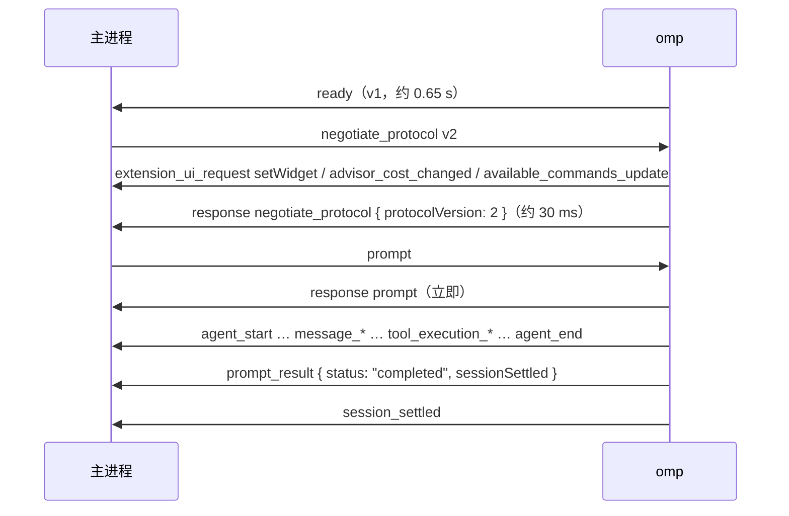

# omp RPC 连接

主进程怎么启动 omp、收发帧、关闭 omp。协议本身以 omp 文档 `rpc.md` 为准，这里只记实测到的行为和要注意的地方。

实测版本：omp 18.12.0（Tern 管理），另用 install.ps1 装的 18.8.7 跑过同一流程；Electron 44.9.0。日期 2026-10-17。

## 启动

```ts
spawn(ompPath, ["--mode", "rpc-ui", "--model", model], {
  cwd,                 // 任务的工作目录，路径里可能有空格和中文，实测没问题
  env: { ...process.env, PI_CODING_AGENT_DIR, /* provider key */ },
  stdio: ["pipe", "pipe", "pipe"],
  windowsHide: true,
});
```

- 参数用数组，不用 `shell: true`。key 走环境变量，不用 `--api-key`。
- 开发和测试时 `PI_CODING_AGENT_DIR` 指向临时目录，见 `AGENTS.md`。
- omp 会在自己下面起一个 `conhost.exe`，这是正常的。

## 握手

时间是从 spawn 开始算的实测值。



实测的 `ready` 帧：

```json
{"type":"ready","protocolVersion":1,"supportedProtocolVersions":[1,2],"maxFrameBytes":1048576,"maxReassembledFrameBytes":67108864}
```

- 协商的应答到达之前，omp 已经会发出别的帧（`extension_ui_request`、`advisor_cost_changed`、`available_commands_update`），读帧时不能假设协商应答是第一帧。
- 即使 agent 目录是空的临时目录，启动和每轮结束时也会收到 `{"type":"extension_ui_request","method":"setWidget","widgetKey":"autoresearch"}`，来自 omp 内置扩展。presentation 类请求不需要回应，不认识的就忽略。18.8.7 也会发这个。

## 读帧

- stdout 按 `\n` 切行，每行 `JSON.parse`。协商 v2 之后，超过 1 MiB 的逻辑帧会拆成连续的 `rpc_chunk`，按 `rpc.md` 的规则校验 `chunkId`、`index`、`count`、`byteLength` 再重组。实测几次运行里最大的帧是 193 KB，还没触发过分块，重组逻辑要用单元测试覆盖。
- `message_update` 默认每帧都带完整的消息快照。一轮带 bash 工具的短对话就录到 550 KB。阶段 2 做对话流时考虑 `set_event_filter` 的 `messageUpdates: "delta"`。子代理转发的 `message_update` 不受这个设置影响，见 `subagents.md`。
- `prompt` 的应答只表示消息被接收，一轮跑完要看同 id 的 `prompt_result`；整个会话安静下来看 `session_settled`。

## 类型从哪来

npm 包 `@oh-my-pi/pi-coding-agent` 里有 `rpc-wire.generated.ts`，可以 `import type`，但装整个包约 1.06 GB。GitHub tag `v<版本>` 下 `packages/coding-agent/src/modes/rpc/wire/` 的同名文件与 npm 包逐字节相同。推荐方案和取舍见 `problem.md` 第 3 题，最终由仓库所有者决定。

- 只引 `modes/rpc/wire/rpc-wire.generated`，不要引 `modes/rpc/rpc-types`（会拉进 1493 个文件）。
- `RpcResponse.data` 是 `unknown`，按命令对应结果类型要用 `RpcWireCommands[K]["result"]`。
- `rpc_chunk` 的帧类型不在 generated 文件里。
- omp 自带的 `RpcFrameDecoder`（`rpc-frame.ts`）不依赖 Bun，但包里只有 `.ts` 源码，Node 不能直接从 `node_modules` 加载，需要拷贝或打包。

## 关闭和进程树

| 情形 | omp | omp 起的子进程 |
|---|---|---|
| 空闲时关闭 stdin | 约 0.1 s 退出，退出码 0 | 无残留 |
| bash 工具运行中关闭 stdin | 取消工具（`tool_execution_end.isError: true`），约 0.1 s 退出，退出码 0 | 被结束，无残留 |
| bash 工具运行中强杀主进程 | 自己退出 | **`PING.EXE` 和它的 `conhost.exe` 留下成为孤儿** |

所以正常退出路径（关窗口、退出应用、自动更新重启）都要先关闭 stdin，再等 omp 退出，超时后按进程树结束（`taskkill /T /F /PID`）。主进程崩溃或被强杀时这些代码都不会运行，只能靠操作系统回收进程树，比如 Windows Job Object 的 `JOB_OBJECT_LIMIT_KILL_ON_JOB_CLOSE`。Node 和 Electron 没有这个 API，具体做法属于新增依赖，待仓库所有者决定。omp 在强杀这条路径上为什么不结束子进程，原因没查（推测是 stdout 断开后走了直接退出的分支）。
