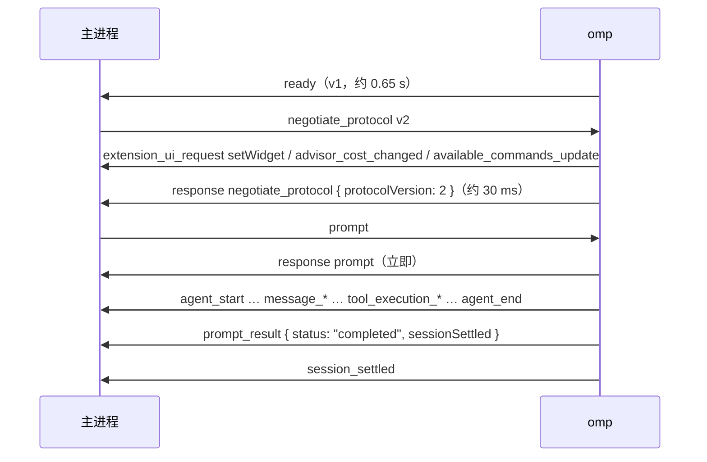

# omp RPC 连接

主进程怎么启动 omp、收发帧、关闭 omp。协议本身以 omp 文档 `rpc.md` 为准，这里只记实测到的行为和要注意的地方。

## 代码

|文件|职责|
|---|---|
|`src/main/omp/discover.ts`|按 PATH 和 PATHEXT 找 `omp`（Windows 上只接受 `.exe`/`.com`，见 `omp-install.md`），执行 `omp --version`，读 exe 上两级目录的 `manager.json`|
|`src/main/omp/frame-decoder.ts`|stdout 字节 → 逻辑帧：按 `\n` 切行、严格 UTF-8、`rpc_chunk` 校验和重组。任何不合规的字节都抛 `RpcProtocolError`|
|`src/main/omp/omp-connection.ts`|`OmpConnection`：启动、握手、`request`（按 id 对应应答）、`prompt`（等到这一条完成）、`onFrame`（其余帧）、`close`|
|`src/shared/omp-wire/rpc-wire.generated.ts`|从 omp tag 拷贝的 wire 类型，见下文"类型从哪来"|

`OmpConnection` 的约定：

- `spawn` 返回时还没开始读 stdout，在同一段同步代码里挂 `onFrame` 不会漏掉握手期间的帧。
- `ready`：收到 `ready` 帧；它声明支持 v2 时再协商 v2，并把重组上限设成 `maxReassembledFrameBytes`。等 `ready` 和协商共用一个截止时间（默认 30 s）；超时、协商失败或 omp 提前退出时 reject，并已结束 omp。
- `prompt(params)`：应答带 `agentInvoked: false` 时直接返回 `{ agentInvoked: false }`；否则返回同 id 的 `prompt_result`。`prompt_result` 同时也从 `onFrame` 发出，排在这一轮所有事件之后。应答 `success: false` 时以 `RpcCommandError` reject；按 `rpc.md`，这之后同 id 的 `prompt_result` 仍可能到来，只从 `onFrame` 发出。`abort_and_prompt` 也以 `prompt_result` 结束，目前只能用 `request` 发、自己从 `onFrame` 等结果。
- `onFrame` 会收到不认识 `type` 的帧（`rpc.md`：未知帧当作未知通知），类型标注是 `RpcServerFrame`，但处理时要有默认分支。监听器或 `tap` 抛错按致命错误处理：结束 omp，错误放进 `exited.error`。
- 协议错误（stdout 不是合规的 NDJSON）时按进程树结束 omp，`exited` 里的 `error` 是那个 `RpcProtocolError`。
- omp 退出后，所有未完成的 `request` 和 `prompt` 都以 `OmpExitedError` reject，之后的调用也一样。
- `close(timeoutMs = 5000)`：关 stdin，继续读 stdout，等 omp 退出；超时后用 `%SystemRoot%\System32\taskkill.exe /T /F` 结束进程树，`exited.killed` 为 true。omp 本身已经退出、只是孙进程还拿着它的 stdout 时，不再 taskkill（pid 可能已被复用），2 s 后直接销毁管道。测试覆盖了"omp 和它起的子进程都被结束"。
- `spawn` 参数非法（比如传入 `.cmd`）时 Node 会同步抛错，这个异常不走 `ready`/`exited`。
- `tap`：收发的每个逻辑帧都会经过它，录制回放用（见 `rpc-replay.md`）。

实测版本：在 Electron 44.9.0 主进程里跑的是 omp 18.12.0（Tern 管理）；install.ps1 装的 18.8.7 只在纯 Node 脚本里跑过同一流程。日期 2026-10-17。

## 启动

```ts
spawn(ompPath, ["--mode", "rpc-ui", "--model", model], {
  cwd,                 // 任务的工作目录，路径里可能有空格和中文，实测没问题
  env: { ...process.env, PI_CODING_AGENT_DIR, /* provider key */ },
  stdio: ["pipe", "pipe", "pipe"],
  windowsHide: true,
});
```

- 参数用数组，不用 `shell: true`。key 走环境变量，不用 `--api-key`。
- 开发和测试时 `PI_CODING_AGENT_DIR` 指向临时目录，见 `AGENTS.md`。
- omp 会在自己下面起一个 `conhost.exe`，这是正常的。

## 握手

时间是从 spawn 开始算的实测值。



实测的 `ready` 帧：

```json
{"type":"ready","protocolVersion":1,"supportedProtocolVersions":[1,2],"maxFrameBytes":1048576,"maxReassembledFrameBytes":67108864}
```

- 协商的应答到达之前，omp 已经会发出别的帧（`extension_ui_request`、`advisor_cost_changed`、`available_commands_update`），读帧时不能假设协商应答是第一帧。
- 即使 agent 目录是空的临时目录，启动和每轮结束时也会收到 `{"type":"extension_ui_request","method":"setWidget","widgetKey":"autoresearch"}`，来自 omp 内置扩展。presentation 类请求不需要回应，不认识的就忽略。18.8.7 也会发这个。

## 读帧

- stdout 按 `\n` 切行，每行 `JSON.parse`。协商 v2 之后，超过 1 MiB 的逻辑帧会拆成连续的 `rpc_chunk`，按 `rpc.md` 的规则校验 `chunkId`、`index`、`count`、`byteLength` 再重组。普通对话里最大的帧约 193 KB，不会分块。发一条 1.4 MB 的用户消息时，收到的最大逻辑帧有 1 400 155 字符，超过 `maxFrameBytes`，只能是分块传来再重组的；在 Electron 44.9.0 主进程里实测正常，这一轮 `prompt_result` 为 `completed`（omp 18.12.0）。具体是哪一帧没有记录，推测是这条用户消息的 `message_start`/`message_end`。`read` 工具读 2 MB 的文件不会产生大帧，omp 自己截断了输出（最大帧约 112 KB）。
- `message_update` 默认每帧都带完整的消息快照。一轮带 bash 工具的短对话就录到 550 KB。阶段 2 做对话流时考虑 `set_event_filter` 的 `messageUpdates: "delta"`。按 `rpc.md`，子代理转发的 `message_update` 不受这个设置影响，见 `subagents.md`。
- `prompt` 的应答只表示消息被接收。应答里带 `data.agentInvoked: false` 时（比如同步完成的内置斜杠命令，或插件命令出错），这条 prompt 已经完成，**后面不会再有 `prompt_result`**；否则一轮跑完要看同 id 的 `prompt_result`。整个会话安静下来看 `session_settled`。

## 类型从哪来

npm 包 `@oh-my-pi/pi-coding-agent` 里有 `rpc-wire.generated.ts`，可以 `import type`，但装整个包约 1.06 GB。GitHub tag `v<版本>` 下 `packages/coding-agent/src/modes/rpc/wire/` 的同名文件与 npm 包逐字节相同。**已定：从 tag 拷贝这个文件进仓库**，不装 npm 包（`problem.md` 第 3 题）。

- 只引 `modes/rpc/wire/rpc-wire.generated`，不要引 `modes/rpc/rpc-types`（会拉进 1493 个文件）。
- `RpcResponse.data` 是 `unknown`，按命令对应结果类型要用 `RpcWireCommands[K]["result"]`。
- `rpc_chunk` 的帧类型不在 generated 文件里。
- omp 自带的 `RpcFrameDecoder`（`rpc-frame.ts`）不依赖 Bun，但包里只有 `.ts` 源码，Node 不能直接从 `node_modules` 加载。它还依赖 `@oh-my-pi/pi-utils/type-guards`，拷贝时要一起拷并改 import 路径，或者用打包器处理。

## 关闭和进程树

| 情形 | omp | omp 起的子进程 |
|---|---|---|
| 空闲时关闭 stdin | 约 0.1 s 退出，退出码 0 | 无残留 |
| bash 工具运行中关闭 stdin | 取消工具（`tool_execution_end.isError: true`），约 0.1 s 退出，退出码 0 | 被结束，无残留 |
| bash 工具运行中强杀主进程（主进程里 `process.kill(process.pid, "SIGKILL")`） | 自己退出 | **`PING.EXE` 和它的 `conhost.exe` 留下成为孤儿** |

所以正常退出路径（关窗口、退出应用、自动更新重启）都要先关闭 stdin，**期间继续读 stdout**（`rpc.md` 要求，否则 omp 可能一直等输出被读走而不退出），再等 omp 退出，超时后按进程树结束（`taskkill /T /F /PID`）。主进程崩溃或被强杀时这些代码都不会运行。**已定**：omp 子进程放进 Windows Job Object（`JOB_OBJECT_LIMIT_KILL_ON_JOB_CLOSE`），由系统回收整棵进程树；Node 和 Electron 没有这个 API，要用原生模块，具体哪个开工前再确认。同时查清 omp 在这条路径上为什么不结束子进程，是 omp 的缺陷就给官方提 PR。原因还没查，推测是 stdout 断开后走了直接退出的分支。
