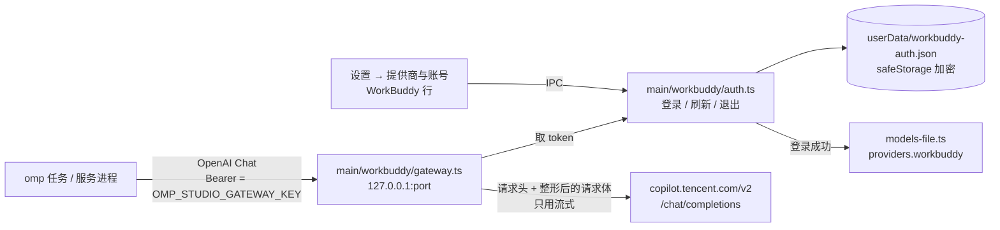

# WorkBuddy 账号内置（计划，未实现）

目标：在 studio 的"设置 → 提供商与账号"里登录 WorkBuddy（腾讯 CodeBuddy 套餐）账号，它套餐里的模型（Hy3、GLM、Kimi、DeepSeek……）出现在模型选择器里，任务直接用。studio 自带这个功能，不装 omp 插件，也不依赖 magpie。

状态：仓库所有者 2026-10-21 要求先出计划。下面第 1 节的决定没拍板之前不动代码。

参考实现：[`@magpie-community/opencode-workbuddy-auth`](https://github.com/magpie-community/plugins/tree/main/packages/workbuddy)（MIT，`index.mjs` 约 1860 行；magpie 内置的 WorkBuddy 已经迁移到这个插件，见 `yetone/magpie` 的 `internal/provider/workbuddy.go` 文件头）。移植代码时保留它的 MIT 版权声明。下文的接口都来自这份源码，**都没有用真实账号实测**。

## 1. 待拍板

| # | 决定 | 选项 | 建议 |
|---|---|---|---|
| D1 | 渠道风险。API 只认 WorkBuddy 客户端：`User-Agent: WorkBuddy/5.5.6`（否则报 10085）加一整套 `X-IDE-*` 请求头；"未批准渠道"的提示词会被拒（11128），插件靠把 system prompt 挪进第一条用户消息来绕过；已有账号因"异常行为"被限制（11140，[magpie#1849](https://github.com/yetone/magpie/issues/1849)） | a. 只带官方请求头、按接口要求整形请求，被 11128 拒绝就原样报错；b. 完整照搬，连提示词挪位一起；c. 不做 | a |
| D2 | 范围 | a. 只接国内版（`copilot.tencent.com`）；b. 再加国际版 WorkBuddy AI（`www.workbuddy.ai`） | a，结构上留一个 `site` 参数，b 以后只是多一份配置 |
| D3 | 自动写 `models.yml`。现在的例外只允许"用户在自定义提供商表单里"写 `providers.<id>`；本功能要在登录、退出、端口变化时自动写 `providers.workbuddy` | a. 批准，并把 AGENTS.md「omp 的边界」第 2 条改成包含这种情况；b. 不批准（没有别的入口能让 omp 看到这个提供商，等于做不了） | a |
| D4 | 主进程新开一个本地 HTTP 端口（网关），多了一个攻击面 | 只监听 `127.0.0.1`、校验 bearer、拒绝带 `Origin` 的请求、校验 `Host` | 按左栏做 |
| D5 | 读取 WorkBuddy 桌面版已登录的账号（`%LOCALAPPDATA%\CodeBuddyExtension\…\workbuddy-desktop.info`） | a. 不做，只用浏览器登录；b. 做 | a：5.6 以后这个文件是加密的，插件也读不了；读别的应用的凭据也越过了我们自己的边界 |
| D6 | 积分余额的显示 | a. 不显示；b. 只在设置页的 WorkBuddy 行里显示；c. 跟会话用量一起放在输入框附近 | b（符合"遥测克制"） |
| D7 | 冒烟用的真实账号 | 仓库所有者提供账号，冒烟时在弹出的浏览器里登录一次（扫码或手机号，没法自动化） | 必须有，否则第 8 节的真实验证都做不了 |

## 2. 架构



为什么要中间这层网关：omp 的 `models.yml` 只能配固定的 `baseUrl`、`apiKey`、`headers`。WorkBuddy 要求每次请求都换的 token（一小时过期，过期前要刷新）、每条消息不同的会话 id 请求头、请求体整形，还要在流式响应里把工具名映射回原名。这些都超出了 `models.yml` 能表达的范围。不写插件的话，只能由 studio 的主进程做转发。

和 omp 的关系：omp 看到的只是一个普通的 OpenAI 兼容提供商（`api: openai-completions`）。studio 不改 omp、不 fork omp、不用 wire schema 之外的命令。

## 3. 登录和凭据（`src/main/workbuddy/auth.ts`）

浏览器登录流程，照插件的 `browserSignIn`：

1. `POST <endpoint>/v2/plugin/auth/state?platform=workbuddy`，带请求头 `X-No-Authorization`、`X-No-User-Id`、`X-No-Enterprise-Id`、`X-No-Department-Info`（值都是 `"true"`）。返回 `{state, authUrl}`。
2. 用系统浏览器打开 `authUrl`（只放行 https，和 `login.md` 的 `open_url` 同一套校验）。界面显示"等待浏览器登录"、"重新打开浏览器"、"取消"。
3. 每秒请求一次 `GET /v2/plugin/auth/token?state=…`，返回码 11217 表示"还没好"，最多等 5 分钟。拿到 `{accessToken, refreshToken, expiresIn|expiresAt, refreshExpiresIn|refreshExpiresAt, domain, tokenType}`。
4. 每秒请求一次 `GET /v2/plugin/login/account?state=…`（12151 表示"还没好"），取 `uid` 和昵称；企业账号再查 `GET /v2/plugin/accounts`，取 `enterpriseId`。
5. 存进 `userData/workbuddy-auth.json`：`{version, accounts:[{site, uid, name, enterpriseId?, cipher}]}`，`cipher` 是用 `safeStorage` 加密的 token JSON。系统没有可用的加密存储时登录直接失败，不退回明文（和 `api-key-store.ts` 一样）。
6. 刷新：token 离过期不到 60 秒时，先 `POST /v2/plugin/auth/token/refresh`（请求头 `X-Refresh-Token`、`X-Auth-Refresh-Source: plugin`、`X-Domain`）再发请求。同一个 refresh token 只用一次（按 token 合并同时发起的刷新）。刷新失败时，只要旧 token 还没过期就继续用。refresh token 也过期了，就报"需要重新登录"。

取消：停止轮询并清掉 `state`，不留半成品。同一时间只允许一个登录。退出登录：删掉这条记录，删掉 `providers.workbuddy`，关掉网关（没有别的账号时）。

只做一个账号（插件就是一个）。多账号轮换等 D2 定了以后再说。

日志只记站点、`uid` 的哈希和结果码；token、手机号、昵称都不进日志。

## 4. 网关（`src/main/workbuddy/gateway.ts` + `src/shared/workbuddy/*.ts` 纯函数）

监听：`127.0.0.1`，端口第一次随机选一个空闲的，记进 studio 设置，以后一直用这个端口（`models.yml` 里的 `baseUrl` 不用跟着变）。端口被占用时换一个新端口，同时改写 `baseUrl`。应用就绪且已登录时启动，`window/shutdown.ts` 的退出路径里关闭。网关不是子进程，没有孤儿进程的问题。

认证：每台机器生成一个随机 32 字节密钥，用 `safeStorage` 加密存放，经 `getApiKeyEnv()` 以 `OMP_STUDIO_GATEWAY_KEY` 注入每个 omp 子进程（TSP 任务、服务进程、`runOmpCommand` 已经全部走这个函数）。`models.yml` 里只写 `apiKey: OMP_STUDIO_GATEWAY_KEY`（变量名，不写明文）。以下请求直接拒绝：

- 没带 bearer 或 bearer 不对 → 401；
- 带 `Origin` 头或 `Sec-Fetch-*` 头（浏览器发来的）→ 403；
- `Host` 不是 `127.0.0.1:<port>` → 403。

路由：

| 路径 | 做什么 |
|---|---|
| `GET /v1/models` | 从 `GET <endpoint>/v3/config` 取 CLI agent 的模型列表（User-Agent `CLI/2.0.0 WorkBuddy/5.5.6`），映射成 OpenAI 的模型列表。缓存 1 小时 |
| `POST /v1/chat/completions` | 整形请求后转发到 `<endpoint>/v2/chat/completions`，响应流原样转给 omp（只在要把工具名映射回去时改写数据块） |
| 其它 | 404 |

请求整形（纯函数 `shared/workbuddy/request.ts`，按插件 README 的「Requests」一节）：

- 请求头：`Authorization`、`X-User-Id`、`X-Domain`、`X-Product: SaaS`、`X-IDE-Type/Name: WorkBuddy`、`X-IDE-Version`、`User-Agent: WorkBuddy/5.5.6`、`X-Requested-With`、`X-Agent-Intent: craft`、`X-Agent-Purpose: conversation`；企业账号再加 `X-Enterprise-Id`、`X-Tenant-Id`。
- 会话 id：`X-Conversation-ID`（按会话），`X-Conversation-Request-ID`（同一次用户发送的所有步骤共用一个），`X-Conversation-Message-ID` 和 `X-Request-ID`（每次请求新生成）。会话从哪来要实测 omp 发出的请求（第 7 节 P0），不行就用第一条用户消息的哈希。
- 请求体：强制 `stream: true`；`max_completion_tokens` 改成 `max_tokens`；`developer` 角色改成 `system`；对象形式的 `tool_choice` 改成字符串；工具 schema 整形（根不是 object、联合类型、`enum` 推断类型、`true/false` schema、元组 `items`、非法 `type`）；工具名里的非法字符换成 `_`，响应里再映射回原名。
- 第一条消息不是 system 时补上 WorkBuddy 的默认 system prompt（插件的做法；D1 选 a 时也需要）。
- D1 选 b 才做：被 11128 拒绝后，把 system prompt 挪进第一条用户消息重发一次。

错误映射（纯函数 `shared/workbuddy/errors.ts`）：把 WorkBuddy 的 `{code,msg}` 转成 OpenAI 格式的 `{error:{message,type,code}}`，状态码保持不变，好让 omp 的错误卡片（`omp.error`）显示原因。10085（客户端不认）、11128（渠道被拒）、11140（账号被限制，附上"在 WorkBuddy 里提交申诉"）、积分不足，各有一句人话。

## 5. 接入 omp

登录成功后，经 `models-file.ts` 写 `providers.workbuddy`：

```yaml
providers:
  workbuddy:
    baseUrl: http://127.0.0.1:<port>/v1
    apiKey: OMP_STUDIO_GATEWAY_KEY
    api: openai-completions
    models:
      - id: glm-5.3
        name: GLM-5.3
        contextWindow: 200000   # 来自 /v3/config
```

- `applyProvider` 现在只写模型的 `id`/`name`。这里要多写 `contextWindow`、`reasoning`、`input`（图片），否则上下文压缩会按 omp 的默认值算。要么给 `models-file.ts` 加一个只给本功能用的写入函数，要么扩展 `CustomProviderInput`，实现时按"同一件事只用一种做法"选一种。
- `providers.workbuddy` 已经存在、但不是 studio 写的（`baseUrl` 不是本机网关）时不覆盖，报冲突。插件的 provider id 也是 `workbuddy`，用户可能装过。
- 写完后 `serviceOmp.close()`，重新读模型列表（和保存自定义提供商同一条路径）。已经在跑的任务要等下次启动才看得到。
- 模型列表变化时（每次启动、每小时）只在列表真的变了才改写文件。
- 终端版 omp 也会看到这个提供商（共用 `models.yml`）。没带 `OMP_STUDIO_GATEWAY_KEY` 时 omp 会把变量名当成字面 key 发出去，网关返回 401；studio 没开时连接被拒。设置页的说明里写清楚"仅在 omp-studio 运行时可用"。

## 6. 界面

- 设置 → 提供商与账号的提供商列表里加一行 WorkBuddy（`ProviderRow` 的同一套样式）：未登录显示"登录"；登录中显示"等待浏览器登录 · 重新打开 · 取消"；已登录显示"已登录 · <昵称>"、"退出登录"，D6 选 b 时再加积分余额。
- 网关启动失败（端口、密钥）在这一行就地报错，走 `reportError`。
- 模型选择器不用改：模型名是 `workbuddy/<id>`，和其它提供商一样。
- 文案中英各一份（`src/shared/i18n/`），检查较长的英文会不会撑破这一行。截图：中英文 × 深浅主题。

## 7. 分阶段

| 阶段 | 内容 | 需要 |
|---|---|---|
| P0 实测 | 真实账号走一遍 state → token → account；`/v3/config` 的返回形状；用 omp 18.12.x 起一个本地假 OpenAI 服务，录下 omp 对 `openai-completions` 自定义提供商发出的请求头和请求体（有没有会话 id、工具 schema 长什么样）；omp 的 system prompt 发给 WorkBuddy 会不会触发 11128。结论写进本文 | D7 |
| P1 登录 | `auth.ts`、凭据存储、IPC `startWorkbuddyLogin` / `cancelWorkbuddyLogin` / `logoutWorkbuddy` / `getWorkbuddyStatus`（只返回状态和昵称，不返回 token）、设置页那一行 | D2、D5 |
| P2 网关 | `gateway.ts`、请求整形、流式转发、工具名映射、错误映射、接入退出流程 | D1、D4 |
| P3 接入 omp | 写入和删除 `providers.workbuddy`、`OMP_STUDIO_GATEWAY_KEY` 注入、端口迁移、模型列表同步 | D3 |
| P4 收尾 | 本文改成正式的 `workbuddy.md`、`login.md` 加链接、`spec.md` 补上这一行、CHANGELOG、AGENTS.md 例外条款（D3） | |

## 8. 测试

- 单测（纯函数）：请求整形每一条（schema 的各种形状、工具名往返、`max_tokens`、`developer`、`tool_choice`）；错误映射；token 过期判断、合并同时发起的刷新；会话 id 的稳定性（同一次用户发送内相同，换一条消息就变）。
- 单测（主进程，本地假 WorkBuddy 服务器）：登录轮询（11217/12151 → 成功、超时、取消）；刷新成功和失败；网关拒绝无 key、错 key、带 `Origin` 头、`Host` 不对的请求；流式响应完整转发、中途断开；`models.yml` 的写入保留注释，遇到不是 studio 写的 `workbuddy` 不覆盖，路径带空格和中文。
- e2e（`test/e2e/workbuddy.e2e.ts`，假服务器 + 假 omp）：登录 → 行状态变化 → 模型出现在选择器 → 退出后消失。
- 冒烟（真实 omp + 真实账号，D7）：登录，新建任务选 `workbuddy/<某个模型>`，跑一轮带 bash 工具的对话，看事件流跑完；关掉 studio 后确认没有残留进程、端口已释放；临时 `PI_CODING_AGENT_DIR`，用完删掉。

## 9. 风险

- **账号被封**（见 D1）。是用户的账号承担，但功能是 studio 内置的。设置页登录前弹一次说明（"非官方客户端，可能被 WorkBuddy 限制"），用户确认后才开始登录。
- **WorkBuddy 改接口或改客户端校验**（版本号、请求头、错误码）就会失效。常量集中在 `shared/workbuddy/site.ts`，失效时以原话报错，不静默重试。
- **两边写 `models.yml`**：终端版或 magpie 同时改这个文件时没有跨进程锁（`custom-models.md` 已知问题）。magpie 接管 omp 后会写它自己的 `providers.magpie`，和 `workbuddy` 不冲突。
- **网关挂掉时任务报错**：omp 会按 `retry.*` 重试（`tsp-real-omp-probes.md` §7：每次失败前约 33 秒没有任何提示）。网关自身的错误要立刻返回，不能让连接挂着。
