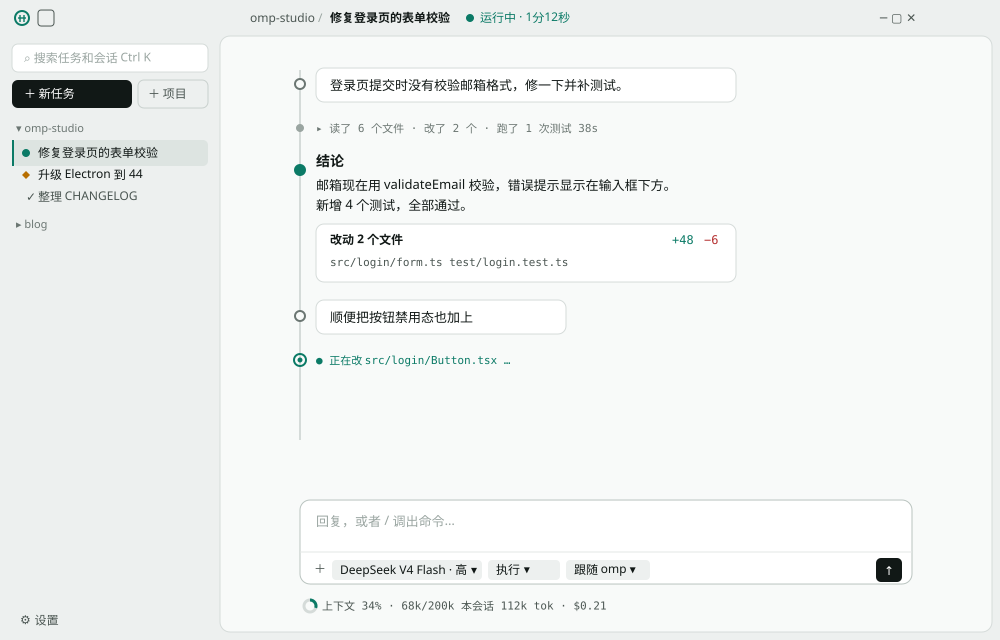
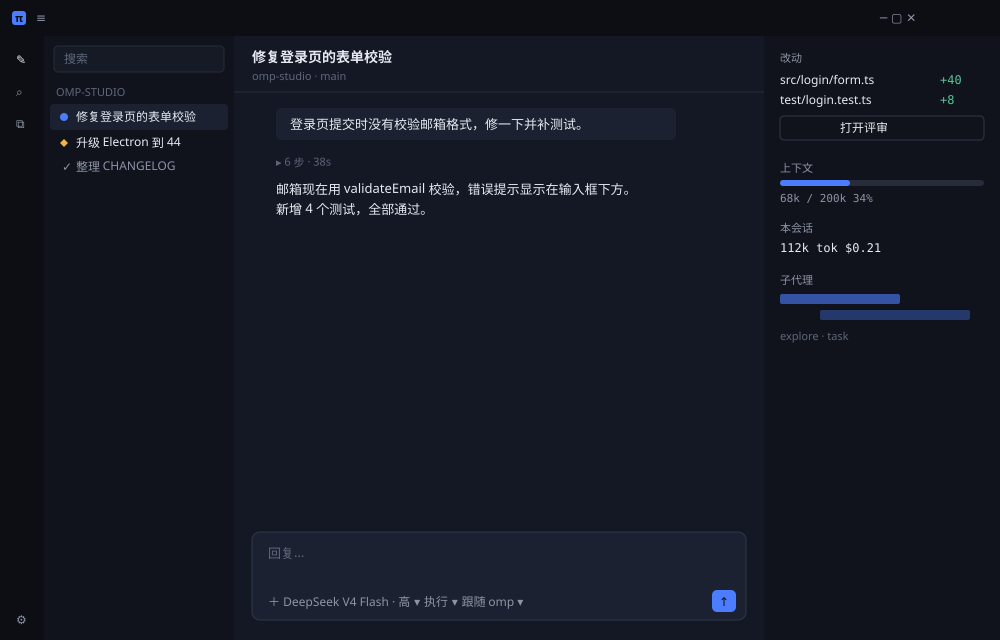

# 阶段 2.6 设计方向（已确认：方向 A「仪表」，2026-10-18）

> 状态：**确认**（仓库所有者 2026-10-18 选 A「仪表」，§5 五项均按推荐答案：松石绿、顶栏去掉后退/前进、完成态中性对勾、标志圆环 + π 临时版）。下面保留提案原文；落地见 `spec.md` §2–4。原状态：提案，未动代码。阶段 2.6 定了"动手前先出新的设计方向给仓库所有者确认"。这份文档给出两个方向和一份不管选哪个都要做的改动清单，请在第 5 节选一个（或者指出要混搭哪些部分）。确认后再改 `docs/design/spec.md` 和 `tokens.css`，然后逐项实现。
>
> 线框图里的颜色就是提议的色板，尺寸按 1200×800 窗口缩到 1000 宽。线框只表达布局和视觉语言，不是像素稿。

## 1. 现在哪里像 Claude Code

对照 v1 截图（`screenshots/conversation-*.png`）和 spec 第 3 章，像的地方集中在骨架上，不在细节：

| 部位 | 现在 | 为什么像 |
|---|---|---|
|顶栏|`≡ ▯ ← →` 四个图标 + 右上文字链接，通栏和侧栏同色|spec §3.1 写的就是"照 Claude 桌面版"|
|主区面板|只有左上角圆角，贴着窗口右边和下边|和 Claude 桌面版的面板形状一样，仓库所有者也指出左右圆角不一致|
|对话|用户消息是右缩进的浅色气泡，回答是无底色正文，列宽 720 居中|这是 Claude/ChatGPT 共同的样子，没有 omp-studio 自己的结构|
|输入框|大圆角卡片，胶囊排在框内底部|同上；控件和输入区贴得太紧|
|色彩|中性灰 + 一个紫色强调色|灰阶本身不像谁，但没有任何识别度|

不像 Claude、可以保留的：状态点的形状（菱形 = 等你、实心点 = 进行中）、过程默认折叠成一行、改动卡片、门停在输入框上方。这些是 omp-studio 的"结果优先"在界面上的体现，两个方向都保留并加强。

## 2. 不管选哪个方向都要做的（阶段 2.6 的条目）

| 条目 | 做法 |
|---|---|
|去掉输入框下方的历史会话列表|历史只在侧栏（搜索框能搜到会话）；空状态只留项目名和输入框|
|输入框默认贴底|空状态和有对话时输入框都贴在主区底部，不再居中；空状态的上方区域放项目名和最近 3 个任务的入口（可点，不是列表）|
|模型、思考强度控件太挤；模型太多|输入框分两层：上面输入区，下面一条工具行（中间一条 1px 分隔线，留出呼吸）。模型胶囊点开的是**模型选择对话框**：左栏按 provider 分组 + 搜索，右栏是选中模型的参数（上下文长度、能否看图、是否推理、价格），思考强度放在同一个对话框底部|
|显示上下文窗口占用|数据已有：`TaskState.contextUsage`（来自 `get_state`）。放在输入框下方的"仪表行"（方向 A）或右侧检查栏（方向 B）|
|plan 模式|输入框工具行加"执行模式"胶囊：执行 / 计划。**omp 的 plan 模式和对应的 RPC 接口还没查**，wire schema 里没看到 plan 相关命令，实现前先查 omp 文档，查不到就停下来问|
|默认显示本会话消耗|数据：`get_session_stats` 返回 `tokens`、`cost`、`premiumRequests`、`credits`。和上下文占用放在一起|
|主区圆角不一致|方向 A：主区面板四角都圆，右边和下边各留 8px，像一张放在桌上的纸；方向 B：主区不做圆角，三栏用分隔线|
|侧栏：搜索框、添加项目上移|侧栏顶部依次是搜索框、[新任务] [添加项目] 一行两个按钮、项目列表|
|顶栏重新设计|见各方向|
|设置图标是太阳|`sidebar/icons.tsx` 的 `GearIcon` 是一个圆加 8 条短线，看起来就是太阳；重画成带齿的齿轮|
|设置页杂乱、太宽、竖排留白|设置页改两栏表格式排版：标签列固定宽，控件紧跟标签（不再拉到最右），说明放 `ⓘ`；内容区最大宽 880，左对齐，随窗口变宽时右侧不留大片空白。细节等方向确认后单独出一版设置页线框|

"模型与账号"缓存、自定义模型、omp 更新、omp 设置、额度热力图、后台运行这几项是功能，不依赖设计方向，另做。

## 3. 方向 A「仪表」（推荐）

一句话：**像一件精密工具，而不是聊天软件。** 对话是一次次运行的记录，状态和数字像仪表读数一样一直在那里，但不吵。

**识别元素**

1. **运行脊线**：对话列左侧一条细竖线，每一轮挂在线上——空心圆是你的消息，小灰点是折叠的过程，实心圆是结论，带环的圆是正在进行。读起来像一份运行日志，一眼能看出哪一轮做完了、结论在哪。这是最主要的识别元素，Claude、Codex 都没有。
2. **仪表读数**：模型 id、路径、token 数、费用、耗时、上下文占用一律用等宽字体、`--text-2`，排成一行。上下文占用画成一个小圆环（同时是 omp 的 "o"）。
3. **顶栏 = 任务条**：左边是标志和菜单；中间是 `项目 / 任务标题` 和运行状态（状态点 + "运行中 · 1分12秒"）；右边系统三键。后退、前进从顶栏拿掉，留在快捷键（Alt ←/→）和鼠标侧键上；侧栏开关并进菜单和 Ctrl B。
4. **标志**：圆环里一个 π（oh-my-pi），只用强调色描线，出现在顶栏左上和空状态。

**色板**（只换颜色，层级和语义沿用 spec §2.5；对比度已用 WCAG 公式算过）

| token | 浅色 | 深色 | 说明 |
|---|---|---|---|
|`--bg-sidebar`（顶栏、侧栏）|`#EDF0EF`|`#0B0E0D`|带一点绿的矿物灰，不是纯灰|
|`--bg-app`（主区）|`#F8FAF9`|`#111514`||
|`--bg-raised`|`#FFFFFF`|`#171C1A`||
|`--text`|`#111816`（17.2:1）|`#E6ECEA`（15.4:1）||
|`--text-2`|`#4B5652`（7.3:1）|`#A3AFAB`（8.1:1）||
|`--text-3`|`#5F6A66`（主区 5.4 / 侧栏 4.9）|`#7F8B87`（5.2:1）||
|`--accent`（松石绿）|`#0B7A66`（5.0:1；白字在上 5.3:1）|`#3FCBAE`（9.1:1；深字在上 8.4:1）|只用在：进行中、主按钮、焦点环、链接、上下文圆环|
|`--st-waiting`|点 `#B76E00`（3.8:1，非文本）/ 字 `#8E5A00`（5.5:1）|`#F0B545`|不变：琥珀只给"等你"|
|`--st-done`|`--text-2` 的对勾|同左|完成不再用绿色，免得和强调色混；完成本来就不需要提醒|
|`--st-error`|`#B42E2E`（5.9:1）|`#F27373`|基本不变|

**形状**：圆角整体收小一档（卡片 8、输入框 10、按钮 6），比 Claude 的大圆角更"硬"、更像工具。主按钮用近黑底（深色主题用近白底），强调色只给状态，不给大面积按钮。

**代价和风险**：脊线要和过程折叠、门、子代理泳道（阶段 5）一起设计，组件改动面最大的是 `conversation/`；等宽字体的读数行在中文界面里要控制长度，窄窗口时只留上下文和费用。

## 4. 方向 B「工作台」

一句话：**三栏工作台，结果放在右边常驻。** 对话在中间，右侧检查栏一直显示这次任务的改动、上下文、消耗和子代理，评审（阶段 3）和泳道（阶段 5）以后都长在这一栏里。

**识别元素**

1. **右侧检查栏**（宽 236，可收起）：改动文件列表 + "打开评审"、上下文条、本会话消耗、子代理泳道缩略。结果优先体现在布局上：不用翻对话就能看到改了什么。
2. **最左一条图标轨**：新任务、搜索、项目、设置四个入口竖排，侧栏列表在它右边，可以单独收起列表只留图标轨。
3. **主区面板头**：任务标题 + `项目 · 分支`，顶栏只剩标志、菜单和系统三键。
4. **深色优先**：钴蓝强调色配深蓝灰底，气质偏 IDE。

**色板**（主要列深色）

| token | 深色 | 浅色 |
|---|---|---|
|`--bg-sidebar`|`#0C0E14`|`#F1F3F7`|
|`--bg-app`|`#141824`|`#FAFBFD`|
|`--text`|`#E7EAF2`（14.7:1）|`#14171F`|
|`--text-3`|`#7A8297`（4.6:1）|`#636B7E`（5.2:1）|
|`--accent`（钴蓝）|`#4C7DFF`（4.8:1；深字在上 5.2:1）|`#2F5BEA`（5.3:1；白字在上 5.5:1）|

**代价和风险**：三栏在 1200 宽以下就挤（对话列只剩约 500px），1000 以下要把检查栏变成抽屉；常驻的数字和泳道违背"克制"，和 omp-desktop"遥测栏占 1/5 屏"的问题只差一步；钴蓝 + 深蓝灰在 IDE 和其他 agent 桌面端里很常见，识别度不如方向 A。

## 5. 请仓库所有者决定

| 问题 | 选项 | 推荐 |
|---|---|---|
|1. 方向|A「仪表」/ B「工作台」/ 混搭（例如 A 的色板和脊线 + B 的可收起检查栏，检查栏默认收起）|A|
|2. 强调色|A 的松石绿 / B 的钴蓝 / 别的颜色（给一个参考就行）|松石绿|
|3. 顶栏去掉后退/前进按钮|去掉（留快捷键和鼠标侧键）/ 保留|去掉|
|4. 完成状态的颜色|中性对勾（不再用绿）/ 保留绿色|中性对勾|
|5. 标志|圆环 + π / 先不做标志，用文字|圆环 + π，正式名定了再画正式版|

确认后的顺序：先改 `spec.md` 第 2–4 章和 `tokens.css`（一个提交，所有截图重拍），再按第 2 节的表逐项实现，每项附中英文、深浅主题截图。
